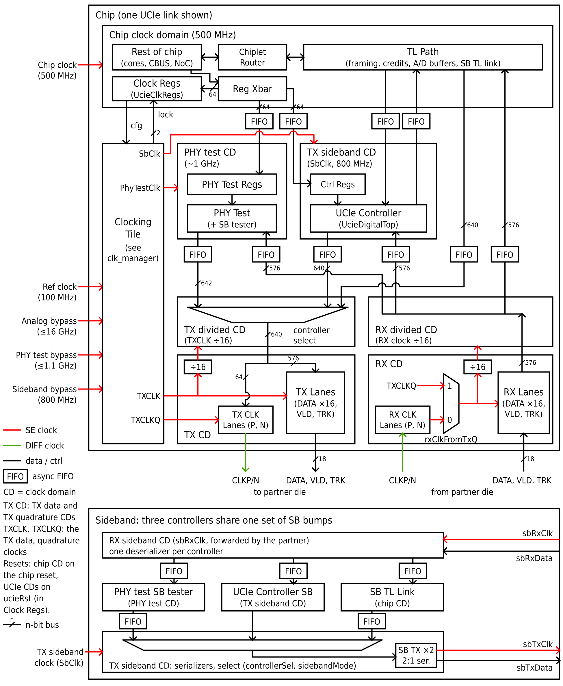
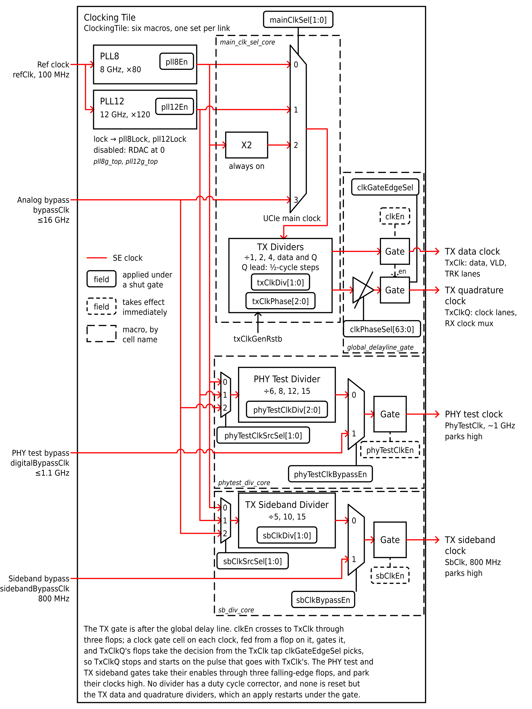

# PhyTest bring-up guide

This guide covers bringing up a UCIe link on silicon under PhyTest, the IP's built-in link tester.
It is generic to the IP. Chip-specific details (base addresses, which bumps carry which clock, how
software reaches the registers) live with the chip. For Iris, see `docs/ucie_bringup.md` in the
Iris repository.

**Conventions**
- Register names follow the generated C header (`UCIE_...`). `GenUcieHeader` in
  `scala/src/tilelink/Codegen.scala` emits it. Regenerate it from the chip's own `UcieTLParams`
  whenever the IP or the parameters change, because they size the per-lane arrays.
- Offsets are relative to `base`, the link's `UcieTLParams.address`. Every generated helper takes
  `base` as its first argument.
- Widths are in bits. A write keeps only the low bits of a field (section 4.0).
- There are no bench numbers yet. Statements that depend on analog behavior, and inferences, are
  marked.

**Figures** (in `docs/figures/`)
- `top_level_clocking_doc.png`: all clock domains, their async FIFOs, and the sideband controllers.
- `clk_manager_doc.png`: the clocking tile's six macros, and which fields are applied or immediate.
- `clk_dividers_doc_chains.png`: the PHY test and TX sideband divider chains.
- `clk_dividers_doc_tx.png`: the TX clock generator and TX gate.
- `clk_dividers_doc_blocks.png`: the divider stages at flop level.
- `clk_dividers_doc_disable.png`: the TX, PHY test and sideband gates at gate level.
- `lane_clock_distribution.png`: the lane clock trees, delay lines, and RX clock select.

---

## 1. Clocking structure



### 1.1 Clocks and what they clock

| Clock | Source (reset default first) | Selected by | Clocks |
|---|---|---|---|
| **Chip clock** | SoC clock. | Fixed | `UcieClkRegs` and the bus side of the register port. |
| **PHY test clock** `PhyTestClk` | `digitalBypassClk` pin (≤ 1.1 GHz per the figure), or PLL8, PLL12 or analog bypass ÷6, 8, 12 or 15. Nominal ~1 GHz. | `phyTestClkBypassEn`, `phyTestClkSrcSel`, `phyTestClkDiv` (applied); gate `phyTestClkEn` | `UcieTLRegs` (PhyTest, lane-control and debug registers); `PhyTest`; every `RxAfeCtl`, clock lanes included; the sideband tester's registers. |
| **TX sideband clock** `SbClk` | `sidebandBypassClk` pin (800 MHz), or PLL8, PLL12 or analog bypass ÷5, 10 or 15. 800 MHz is PLL8/10 or PLL12/15. | `sbClkBypassEn`, `sbClkSrcSel`, `sbClkDiv` (applied); gate `sbClkEn` | `UcieController` (UCIe digital stack, its registers, its end of the mainband queues); every sideband serializer. |
| **UCIe main clock** | Analog bypass pin `bypassClk` (≤ 16 GHz), PLL8 (8 GHz), PLL12 (12 GHz), or PLL8 X2 (16 GHz). | `mainClkSel` (applied) | Only the TX data and quadrature dividers. It has no gate. The TX gate (`clkEn`) is after the global delay line. |
| **TX data clock** `TxClk` | Main clock ÷1, 2 or 4, then the TX gate. | `txClkDiv` (applied); gate `clkEn` | TX data, valid and track lanes; PhyTest's TX debug, loopback TX and loopback RX lanes; the global TX ÷16. |
| **TX quadrature clock** `TxClkQ` | `TxClk` advanced by `txClkPhase` main-clock half-cycles, then the global delay line (a fixed delay plus 64 thermometer taps, under 2 ps each), then the TX gate. | `txClkPhase`, `clkPhaseSel` (applied); gate `clkEn` with `clkGateEdgeSel` (applied) | The two forwarded-clock TX lanes; the RX clock tree when `rxClkFromTxQ` = 1. |
| **TX divided clock** `txDivClk` | `TxClk` ÷16. | Follows `TxClk` | TX word hand-off to the tiles; PHY end of every TX queue; TX underflow flags. |
| **RX clock** | The partner's forwarded clock on `rxClkP` through the RX clock lane gate `rxClkEn`, or this die's `TxClkQ` when `rxClkFromTxQ` = 1. | `rxClkEn`, `rxClkFromTxQ` | Every RX data, valid and track tile; the global RX ÷16. |
| **RX divided clock** `rxDivClk` | RX clock ÷16. | Follows the RX clock | RX word hand-off; PHY end of every RX queue; RX overflow flags. |
| **RX sideband clock** | The partner's `sbTxClk` on the `sbRxClk` bump. | n/a | Every sideband deserializer. |
| **Reference clock** `refClk` | 100 MHz bump. | n/a | Both PLLs (×80, ×120). Needed only when a PLL is used. |

`figures/lane_clock_distribution.png` shows how the TX, RX and loopback lanes get their clocks.

Two properties hold by design:
- Nothing done to the main clock reaches the PHY test or TX sideband clock. They divide a PLL or a
  bypass pin, not the main clock.
- The PHY test clock sequences the RX AFEs. It must run whenever any lane receives, even when the
  UCIe digital stack is in control.

### 1.2 The clocking tile



`ClockingTile` (`scala/src/phy/macros/clocking/Common.scala`) connects six black-box macros. Each
UCIe port has its own six, PLLs included.

| Macro | What it does |
|---|---|
| `pll8g_top`, `pll12g_top` (cells `8gpll_top`, `12gpll_top`) | ×80 and ×120 from `refClk`. `pll8En`/`pll12En` = 0 sets the RDAC (`Dbias`) to 0, which turns the PLL off, and holds its digital loop in reset. |
| `main_clk_sel_core` | Main clock mux, X2 doubler (always on with PLL8), and the `TxClk` and `TxClkQ` dividers with `TxClkQ`'s coarse phase. |
| `global_delayline_gate` | Global delay line on `TxClkQ`, then the TX gate on both clocks. |
| `phytest_div_core` | Source mux, ÷6/÷8/÷12/÷15, bypass mux, gate. |
| `sb_div_core` | Source mux, one mux for ÷5/÷10/÷15 and bypass, gate. |

**Silicon caveats.**
- `Common.scala` marks pins the cells don't have yet: the PLLs' `clk_out` and `lock`,
  `main_clk_sel_core`'s divider `reset`, the divider cores' source muxes, and the gate's `enable`,
  `edgeSel` and data clock pins. If `lock` isn't wired, see step 2.
- Each PLL's loop settings (`kp`, `ki`, `code_init`, `code_byp`, `auto_en`), its RDAC code
  (`Dbias`) and PLL8's `Dcoarse` have registers (section 4.0). They reset to placeholders until
  the PLL designer gives nominal values: zero, with `Dbias` at mid-scale. `Dbias` = 0 leaves an
  enabled PLL off.
- The RX clock lane cell must synchronize its gate enable, as its model does (below).
- The PLL's digital loop reset comes from the chip clock. Check that the PLL synchronizes it to
  `refClk`.
- The TX divider reset (`txClkGenRstb`) must release on a path that fits in whole main-clock
  periods, so `TxClkQ` restarts at the same lead every time.

**Gates.** All three gates park their clock: the TX gate low, the PHY test and sideband gates high.
- **TX gate (`clkEn`).** Safe to write at any time. A change takes effect 6–7 TxClk periods later,
  and only while TxClk runs. It never cuts a pulse short, and TxClkQ stops and starts on the pulse
  that matches TxClk's, at any lag. The TX dividers keep running while the gate is shut, and every
  TX mux, divider and delay code is before it.
  - On silicon, a flop's clock-to-output plus the clock gate cell's setup must fit in one TX clock
    period at the slowest corner. The cell designer's timing signs this off.
- **TX gate edge select (`clkGateEdgeSel`).** The TX gate's decision passes through flops on TxClk,
  and the TxClkQ side samples one of them. 0 picks the fourth flop, which changes as TxClk rises. 1
  picks the third flop through a latch open while TxClk is low, which has the same decision half a
  period earlier. Neither setting can cut a pulse.
  - Each setting has a *race*: the lag of TxClkQ behind TxClk at which the sampled flop changes
    just as the TxClkQ flops sample it. A gate change at that lag may take effect on either of two
    TxClkQ pulses. The RX clock burst can then shift by one pulse against the data from one reopen
    to the next.
  - 0's race is at the fourth flop's clock-to-output plus the select's delay (0 in the model; on
    the chip, from the cell's timing). 1's race is half a period earlier, if the latch's
    clock-to-output is close to the flop's. Each race is the flops' setup plus hold wide.
  - **Rule:** set it to 1 when the lag is within a quarter period of 0's race, and 0 otherwise. The
    chosen race is then a quarter period away, less half its width.
  - The lag is the delay line's fixed delay plus taps × the tap delay, minus `txClkPhase`
    main-clock half periods, plus the difference between the cell's two paths, modulo the TX clock
    period. At ÷1 the taps alone span most of a period at 8 GHz, across both races.
  - It is applied with the delay code and phase (section 1.4). It matters only when the gate opens
    or shuts. Reset is 0. No program sets it yet, because the race lags come from the cell, which
    hasn't been built.
- **PHY test and sideband gates (`phyTestClkEn`, `sbClkEn`).** Safe to write at any time. A change
  takes effect 3–4 periods of that clock later, and only while it runs.
- **RX clock lane gate (`rxClkEn`).** In the clock lane cell, built like the TX gate: three flops
  on the RX clock synchronize the enable, then a clock gate cell. Safe to write at any time. A
  change takes effect on the fourth RX clock edge after it, and only while the RX clock runs. With
  the partner's clock parked, a write waits for its next edges: the first three pass at the old
  setting.

The muxes before the gates are **not** glitch-free. Change a source only with the gate shut. The
apply sequencer (section 1.4) does this.

**Divider codes.** `ClockingTile` translates the register codes to each cell's codes.

| Field | Bits | Codes |
|---|---|---|
| `mainClkSel` | 2 | 0 PLL8, 1 PLL12, 2 X2 (16 GHz; needs PLL8), 3 analog bypass |
| `txClkDiv` | 2 | 0 ÷1, 1 ÷2, 2 ÷4, 3 = ÷4 |
| `txClkPhase` | 3 | 0 … 2·div − 1: the `TxClkQ` lead in main-clock half-cycles. No effect at ÷1. |
| `clkPhaseSel` | 64 | Thermometer code, one bit per tap. Nothing checks it; a code with holes goes to the cell as is. |
| `phyTestClkSrcSel`, `sbClkSrcSel` | 2 | 0 PLL8, 1 PLL12, 2 analog bypass, 3 = analog bypass |
| `phyTestClkDiv` | 3 | 3 ÷6, 4 ÷8, 5 ÷12, 6 ÷15, 7 = ÷15. 0, 1 and 2 select ÷8. |
| `sbClkDiv` | 2 | 1 ÷5, 2 ÷10, 3 ÷15. 0 selects ÷10. |
| `x2En` | 1 | Drives nothing; the doubler has no enable. |

**Duty cycles.** There is no duty-cycle corrector. Even ratios give 50%. `PhyTestClk` at ÷15 is high
9 of 15 source cycles. `SbClk` is high 3 of 5 at ÷5 and 10 of 15 at ÷15, so 800 MHz from PLL12 is
67/33. The PHY test and sideband dividers free-run and are never reset.

**TX dividers.** The `TxClk` and `TxClkQ` dividers share one reset, `txClkGenRstb`. The UCIe reset
and the TX divider reset hold it, and every apply that changes TX clocking pulses it (section 1.4).
So `TxClkQ` always restarts at the lead `txClkPhase` sets.

**Keep the main clock fast; divide for low rates.** A coarse phase step is half a main-clock
period. The global line's taps span it only for main clocks of about 5 GHz and up. Below that, a
sweep has gaps. Get a low line rate from `txClkDiv` on an 8 GHz or faster main clock, not
from a slow bypass clock.

### 1.3 Line rates, and the rule for the PHY test clock

A TX tile is a 32:1 serializer: 32 bits per lane per `txDivClk` cycle. It sends on both edges of
`TxClk`, so `txDivClk` = `TxClk`/16 and the lane rate is 2 × `TxClk`. The RX tile is the matching
1:32 deserializer.

| Main clock | `txClkDiv` | `TxClk` | Lane rate | UI | `txDivClk` (packet clock) |
|---|---|---|---|---|---|
| 8 GHz (PLL8 or bypass) | ÷1 | 8 GHz | 16 GT/s | 62.5 ps | 500 MHz |
| | ÷2 | 4 GHz | 8 GT/s | 125 ps | 250 MHz |
| | ÷4 | 2 GHz | 4 GT/s | 250 ps | 125 MHz |
| 12 GHz (PLL12) | ÷1 / ÷2 / ÷4 | 12 / 6 / 3 GHz | 24 / 12 / 6 GT/s | | 750 / 375 / 187.5 MHz |
| 16 GHz (X2) | ÷1 / ÷2 / ÷4 | 16 / 8 / 4 GHz | 32 / 16 / 8 GT/s | | 1000 / 500 / 250 MHz |

**The PHY test clock must be faster than both packet clocks**: this die's `txDivClk`, and the
partner's, which arrives as this die's `rxDivClk`. During a run, PhyTest puts one word per PHY test
clock into its TX queue and takes one per PHY test clock from its RX queue. The PHY end sends a word
every packet clock (the next queued word, or one of `TxClkGater`'s own; section 8.1). Its RX queue
takes a word every packet clock and can't be stalled. Between runs and bursts, PhyTest queues
nothing.

If the PHY test clock is slower, words drop silently and read as bit errors. Two sticky flags record
it, and the datapath reset clears both:
- `UCIE_TX_TEST_FIFO_UNDERFLOW`: the TX queue ran empty mid-run, after a word that said more of
  the run followed.
- `UCIE_RX_TEST_FIFO_OVERFLOW`: the RX queue overflowed.

If the next data word isn't queued in time, `TxClkGater` sends an idle word instead. With the
forwarded clock running, the run gets an extra idle word, and the RX still takes a word every packet
clock, faster than PhyTest drains it. With the clock gated, the burst splits in two, each part with
its own postamble. A looped-back link then shows both flags = 1, with both packet clocks metering the
same. Between two dies, the RX flag sets on the die with the slower PHY test clock, whichever die
sends.

Equal nominal rates are safe only when both clocks come from one source. With two unlocked
generators at ~100 ppm, a 32-entry queue drifts into underflow or overflow in under a millisecond
(inference). At 32 GT/s the packet clock is 1 GHz, so a 1 GHz PHY test clock has no margin.

PHY test clock choices from the PLLs:

| Source | ÷6 | ÷8 | ÷12 | ÷15 |
|---|---|---|---|---|
| PLL8 | 1.33 GHz | **1 GHz** (the preset `phyTestClkDiv` = 4) | 667 MHz | 533 MHz |
| PLL12 | 2 GHz | 1.5 GHz | **1 GHz** | **800 MHz** |

Use only rates the PHY test domain was timing-closed at. This guide doesn't know that number. The
domain's nominal is ~1 GHz.

### 1.4 How a clock setting reaches the tile

`UcieClkRegs` runs on the chip clock and chip reset, so it stays writable while every PHY clock is
stopped. Every output to the tile comes from a flop, so a mode switch or an apply can't glitch a
PLL enable, mux select or gate enable.

**Applied fields** are shadow registers. Nothing reaches the tile until `UCIE_CLK_CFG_APPLY`:
- `mainClkSel`, `txClkDiv`
- `pll8En`, `pll12En`, `x2En`
- `phyTestClkSrcSel`, `phyTestClkDiv`, `phyTestClkBypassEn`
- `sbClkSrcSel`, `sbClkDiv`, `sbClkBypassEn`
- `txClkPhase`, `clkPhaseSel`, `clkGateEdgeSel`
- each PLL's loop settings and RDAC code (`UCIE_PLL8_*`, `UCIE_PLL12_*`; section 4.0)

An apply runs these steps:
1. Shut the TX gate. Shut the PHY test or sideband gate only if this apply changes something under
   it and `clkCfgGatePhyTest`/`clkCfgGateSb` allows it (both reset to 1). Drop any earlier
   `UCIE_CLK_CFG_UNGATE_REQ`.
2. Wait `UCIE_CLK_CFG_GATE_DWELL` chip cycles (reset 32).
3. Copy the shadows into the live registers, and hold the TX data and quadrature dividers in reset.
4. Wait for the ungate condition.
5. Release the TX dividers, and wait 4 cycles.
6. Reopen the gates.
7. Wait `UCIE_CLK_CFG_GATE_DWELL` more cycles, then clear `UCIE_CLK_CFG_BUSY`.

`UCIE_CLK_CFG_BUSY` reads 1 from the `UCIE_CLK_CFG_APPLY` write until step 7. Writes during an apply
are safe:
- `UCIE_CLK_CFG_APPLY` written after step 3 runs another apply after this one.
- A PHY test or sideband field written after step 1 changes a clock whose gate is open, so step 3
  leaves it out and another apply follows.

The dwell covers each gate taking its new enable: 4 periods of the PHY test or sideband clock, and
up to 9 TxClk periods for the TX gate (its 6–7, plus the enable's crossing and TxClkQ's lag). At a
500 MHz chip clock, the reset value of 32 needs PHY test and sideband clocks of 62.5 MHz or more,
and a TxClk of 140 MHz or more. For a slower bypass clock, or a faster chip clock, raise the dwell
before the apply. Otherwise that clock can change under an open gate.

**Phase auto-apply** (`UCIE_CLK_PHASE_AUTO_APPLY`, reset 0). With it on, a write to `txClkPhase` or
`clkPhaseSel` starts its own apply. That apply shuts only the TX gate, moves only those two and
`clkGateEdgeSel`, resets the TX dividers only if `txClkPhase` changed, and skips step 4. Turning it
on applies any phase or delay already written. A full apply drops the UCIe controller's clocks-ready
status while it runs; a phase apply doesn't. So use auto-apply to move the phase under a running
controller. Write `clkGateEdgeSel` before the phase or delay code, so the gate never opens or shuts
with one new and the other old.

**Ungate condition** (`UCIE_CLK_CFG_UNGATE_SRC`):

| Value | Condition |
|---|---|
| 0, `pllLock` (reset) | Lock from every PLL that a reopened clock now divides. The bypass pin counts as locked. |
| 1, `mmio` | Wait for `UCIE_CLK_CFG_UNGATE_REQ`. |
| 2, `delay` | `UCIE_CLK_CFG_UNGATE_DELAY` chip cycles; reset value 1024. |
| 3 | No source. Acts as `mmio`. |

Writing `UCIE_CLK_CFG_UNGATE_REQ` during step 4 ends the wait, whatever the source.

**PLL enables** are exactly what was applied. Turning off a PLL that the PHY test or sideband clock
divides stops that clock with its gate open. That is allowed, for example to stop a PLL while
keeping the mux on it. While that clock is stopped, don't touch its register window (section 3).
Enable the PLL again with an apply. A reopened gate waits for lock under the `pllLock` source.

**Gate enables and the FSM.** `clkEn`, `phyTestClkEn` and `sbClkEn` hold what software wrote. The
gate gets the register AND NOT the apply's hold. An apply holds `clkEn` (and `phyTestClkEn` or
`sbClkEn` if it changes that clock) low from step 1 to step 6, and nothing else. A write during an
apply is kept: a 0 shuts the gate at once, and a 1 opens it when the apply ends.

**Immediate fields** take effect when written, and no FSM touches them: `rxClkEn`, `rxClkFromTxQ`,
`txDividerRst`, `rxDividerRst` and `ucieRst`.
- `rxClkFromTxQ` switches a plain mux. Change it only with both clocks stopped: `clkEn` = 0, and
  `rxClkEn` = 0 written while the partner's clock ran (or that clock parked). The switch then
  makes at most one clean edge, which every RX divider sees alike, so they stay in step. With
  either clock running, a switch can send a runt pulse that some dividers count and others miss;
  then realign the RX dividers (section 2.4).

**Manual mode.** `UCIE_CLK_MANUAL_EN` = 1 drives every clock output straight from its own register:
no apply and no rate table. Use it to sequence by hand. `txClkPhase` and `clkPhaseSel` then change
as written, under a running clock unless `clkEn` = 0. Entering or leaving manual mode changes no
output. The resets behave the same in both modes: `ucieRst` holds both divider resets.

**Rate table.** `UCIE_RATE_CFG` + 8·rate, with `freqSelAutoEn`, is for the UCIe digital stack's
training. PhyTest doesn't use it; leave `freqSelAutoEn` = 0. An all-zero entry selects PLL8 with no
PLL on. An entry that turns off a PLL the PHY test or sideband clock divides stops that clock.
An apply starts once `freqSel` has held still for 3 chip cycles, and copies the entry for the rate
it started on. If the rate moves during the apply, another apply follows.

### 1.5 Clock domain crossings

Only the crossings that set a rule for software:

| Crossing | Rule |
|---|---|
| Bus → `UcieTLRegs` (PHY test clock) and bus → `UcieController` (sideband clock) | One-entry asynchronous crossing. Accepts no request until the destination domain is clocked and out of reset (section 3). |
| PHY test clock ↔ `txDivClk`/`rxDivClk`, mainband data | Asynchronous queue, depth 32, one per controller per direction. Only the selected controller's TX words reach the lanes. The PHY test clock must outrun both packet clocks (section 1.3). |
| PHY test clock → divided clocks, datapath resets | Asserts at once, even with the divided clock stopped. Releases on the third divided-clock edge after the strobe ends; with that clock stopped, it waits for the clock. The RX words in those edges, and through the queues' reset handshake after them, are dropped: about 16 (section 2.1). So after an RX datapath reset, give the RX that many words of forwarded clock before data it must keep. |
| `UcieClkRegs` → dividers | Asynchronous reset from a flop. **Release only with that direction's clock stopped.** |
| `UcieClkRegs` → TX data and quadrature dividers (`txClkGenRstb`) | Released with the main clock running, behind the shut TX gate. `main_clk_sel_core` must synchronize the release to the main clock, as its model does. |
| Clock meters → chip clock | Gray-coded counters. Needs a skew limit on each bus, less than the fastest metered clock's period (section 1.6). |
| `UcieTLRegs` → lanes and divided-clock datapaths | Static controls, not synchronized. The rules are below. |

The rules for changing `UcieTLRegs` while traffic flows. Only the queue selects need a datapath
reset, because only they can corrupt state that outlives one word:

| Registers | When to change them |
|---|---|
| `controllerSel`, `mainbandMode`, `sidebandMode` | Then run `reset_datapath`. They steer which queue the PHY end reads. A change on a packet-clock edge can leave a queue pointer half-updated. |
| `TxClkGater` settings: `txClkPreamble`, `txClkPostamble`, `txIdlePackets`, `txClkParkAlternate` | Between runs (TX queue empty, no gap running), or reset the TX datapath after. They are read every packet, so a change mid-gap can give one wrong gap. |
| `txClkP`, `txClkN`, `txClkDirect` | With the partner's `rxClkEn` = 0, or realign the partner's RX dividers after. A forwarded-clock word that changes mid-word can send the partner a runt. |
| TX `Dctrl` (in `txctl_N_tile`) | Only with `clkEn` = 0. It moves the TX clock path, and a tile divider can lose a count. |
| `txUiDelay_*`, `rxUiDelay_*`, shufflers, `sampleNegedge` | Any time. At most one word is wrong. Reset the FSMs before the next scored run. |
| Driver segments and EQ, termination, vref, RX `Dctrl`, AFE settings, debug muxes | Any time. They reach analog pins or observation logic only. |
| `txClkGate`, and the controller's `mbTxClkGate` | Any time. Synchronized to the packet clock. |

PhyTest's own settings (modes, seeds, thresholds, counts) are on the PHY test clock with PhyTest,
so they need no crossing. They take effect on the next run or frame.

### 1.6 Clock meters

`UCIE_CLK_METER_PHY_TEST`, `_SB`, `_TX_DIV` and `_RX_DIV` show whether each clock runs, and its
rate. They live in `UcieClkRegs`, so they answer in any state.

How they work:
1. Each metered clock runs its own 16-bit counter, reset only by the chip reset. It keeps counting
   through the UCIe and datapath resets.
2. The counter's value is Gray coded on that clock and crosses into the chip clock through two
   flops. Only one bit changes per count, so each sample is a value the counter held.
3. Every `UCIE_CLK_METER_WINDOW_CYCLES` (1024) chip cycles, the meter stores the change since the
   last window. That is the register value.

So rate = count × f_chip / 1024. A stopped clock reads 0 within two windows. 16 bits cover clocks
up to 64 × f_chip (32 GHz at 500 MHz). The first window after chip reset counts from reset.

A running clock does not mean the domain is out of reset; `ucieRst` must still be 0.

---

## 2. Reset structure

### 2.1 The resets

| Reset | Asserted by | Released | Resets |
|---|---|---|---|
| Chip reset | The SoC | The SoC | `UcieClkRegs` (with `ucieRst` = 1), **asynchronously**, so the clock controls and `ucieRst` hold their reset values before the chip clock runs. The clock meters. The bus side of the crossings. **Nothing else in the block.** |
| `UCIE_RST` (`ucieRst`) | Reset value **1**, set asynchronously by the chip reset (so the UCIe domains are held from power-on), or software | Software writes 0 | Every UCIe domain, each through its own synchronizer: the PHY test domain (`UcieTLRegs`, PhyTest, AFE controllers), the sideband domain (controller and its registers), and both datapaths. Both divider resets, in either clock mode. |
| PHY test and sideband domain resets | `ucieRst`, asynchronously | 3 edges of that domain's clock after `ucieRst` = 0 | Everything PhyTest-side resets **asynchronously**, so it holds reset values from when `ucieRst` asserts, even with no clock: `UcieTLRegs` (lane, termination, AFE and pad controls), PhyTest, `RxAfeCtl`, the sideband tester, and the TX and RX datapaths with `TxClkGater`. PhyTest's software resets (`txFsmRst`, `rxFsmRst`, `txDebugFsmRst`, `trackCntRst`, and modes that hold an FSM) are one-cycle synchronous clears on top. They win over any other write in that cycle. The UCIe controller's registers reset **synchronously**, so only while the sideband clock runs. |
| `UCIE_CONTROLLER_RST` | Reset value **1**. Set by every `ucieRst` (through the sideband domain reset), or by software. | Software writes 0. `setup_ucie_digital` does this once the controller has the lanes. | The UCIe controller: logical PHY, adapter, protocol layer. Not its registers. It keeps the controller from training on whatever it hears while it doesn't have the lanes. |
| `UCIE_TX_DIVIDER_RST`, `UCIE_RX_DIVIDER_RST` | Software level, or `ucieRst` | Software level | TX: the global TX ÷16, every TX tile, PhyTest's TX debug and loopback TX lanes. RX: the global RX ÷16, every RX data tile, PhyTest's loopback RX lane. |
| `UCIE_TX_DATAPATH_RST`, `UCIE_RX_DATAPATH_RST` | Software strobe (held 8 PHY test cycles) | 3 edges of `txDivClk`/`rxDivClk` after the strobe ends. The UI-delay and backup hand-off registers release at once instead, with no synchronizer: they hold only data. | The PHY end of every queue in that direction, which empties it; `TxClkGater`; the underflow/overflow flags; PhyTest's lane queues; the UI-delay and backup hand-off registers. **Not** a divider, **not** an FSM. |
| `UCIE_TX_FSM_RST` | Software strobe | Synchronous | TX FSM to idle; `txPacketsSent` to 0; LFSRs reseeded from `txLfsrSeed`; error injection disarmed; burst state. Also held while `mainbandMode` = `tl`. Not the forwarded-clock gating: `TxClkGater` keeps the level it last parked at, so a run starts where the last one parked. Only the TX datapath reset resets it, to parked low (gated) or running. |
| `UCIE_RX_FSM_RST` | Software strobe | Synchronous | RX FSM, all RX counters and error counts, signature, framing, capture state, self-sync history (and with it auto-seed's); LFSRs reseeded from `rxLfsrSeed`. Also held while `mainbandMode` = `tl` unless `rxMonitor` = 1. |
| `UCIE_DEBUG_TX_FSM_RST`, `UCIE_TRACK_CNT_RST` | Software strobe | Synchronous | The TX debug lane FSM; the track counters. |
| `UCIE_SB_RX_RST` | Software strobe, through a flop on the PHY test clock | At once, with no synchronizer. Release it with the partner quiet, so the forwarded clock is idle. | The sideband tester's receiver, asynchronously: bit counter, stored packets, `UCIE_SB_RX_OVERFLOW`. A `sidebandMode` other than manual holds the whole tester the same way. The TileLink sideband link is held the same way while it isn't selected. |

**How a domain reset releases.** Every release goes through `ucie_rst_sync`: three flops on the
destination clock, cleared asynchronously by the reset. The reset asserts at once and releases on
the third edge after its source deasserts. The three-edge figure assumes the silicon cell also has
three stages; the IP only instantiates it. The source of each reset comes straight off a flop, so it
can't glitch.

**The queues.** Each mainband queue is a rocket-chip `AsyncQueue` in safe mode, with both ends
reset asynchronously. A datapath reset resets only the PHY end. The far end clears its pointer
after a reset handshake through synchronizers. Until that finishes, about 12 divided-clock edges
after the reset releases, the PHY end drops RX words. A word or two of garbage can reach the far
end around the reset. The RX FSM or controller reset that follows discards it.

### 2.2 Reset values that matter for bring-up

Section 4.0 lists every register's reset value. These are the ones that shape the plan.

`UcieClkRegs`:

| Register | Reset | Meaning |
|---|---|---|
| `UCIE_RST` | 1 | The block is held. PhyTest and controller registers **do not answer** (section 3). |
| `UCIE_MAIN_CLK_SEL` / `UCIE_TX_CLK_DIV` / `UCIE_TX_CLK_PHASE` | 3 / 0 / 0 | Main clock from the `bypassClk` pin, ÷1, no coarse phase. |
| `UCIE_CLK_PHASE_SEL` | all 64 taps | The longest global delay. See step 5. |
| `UCIE_CLK_EN` / `UCIE_RX_CLK_EN` | 0 / 0 | TX and RX clocks gated, so the dividers leave reset with no clock. |
| `UCIE_PHY_TEST_CLK_EN` / `UCIE_SB_CLK_EN` | 1 / 1 | PHY test and sideband clocks running. |
| `UCIE_PHY_TEST_CLK_BYPASS_EN` / `_SRC_SEL` / `_DIV` | 1 / 0 / 4 | PHY test clock from the `digitalBypassClk` pin. The divider is preset to PLL8 ÷8. |
| `UCIE_SB_CLK_BYPASS_EN` / `_SRC_SEL` / `_DIV` | 1 / 0 / 2 | Sideband clock from the `sidebandBypassClk` pin. The divider is preset to PLL8 ÷10. |
| `UCIE_PLL8_EN` / `UCIE_PLL12_EN` / `UCIE_X2_EN` | 0 | No PLL running. |
| `UCIE_CLK_CFG_UNGATE_SRC` / `_DELAY` | 0 (PLL lock) / 1024 | An apply waits for PLL lock. |
| `UCIE_CLK_CFG_GATE_PHY_TEST` / `_GATE_SB` | 1 / 1 | An apply gates a clock when it changes that clock's source. |
| `UCIE_CLK_PHASE_AUTO_APPLY` | 0 | Phase and delay wait for `UCIE_CLK_CFG_APPLY`. |

So with nothing written, the block needs three board clocks: `bypassClk`, `digitalBypassClk` and
`sidebandBypassClk`, plus `refClk` if a PLL is used.

`UcieTLRegs`:

| Register | Reset | Notes |
|---|---|---|
| `txctl_N_tile` | `TxLaneCtlIO.off` | Every driver segment off, so every TX lane is high-impedance. |
| `rxctl_N` | `zen` = 0, `zctl` = 0, `vrefSel` = 63, `afeOpCycles` = 16, `afeOverlapCycles` = 2, `dctrl` = 0 | Unterminated. |
| Shufflers | Cancel the tile's bit-reversal tree (`Phy.treeBitOrder`) | Every lane, the TX debug lane included, so words go on the wire in plain bit order. |
| `txClkP`, `txClkN` | `0x55555555`, `0xAAAAAAAA` | A running forwarded clock out of reset, for `TxClkGater`'s idle words and `txClkDirect`. |
| `txValid`, `rxValid` | 0 | No valid until written. `setup_ucie` writes `0x0F0F0F0F` to both. |
| `txUiDelay_*`, `rxUiDelay_*` | 0 | No lane delayed. The deserializers use their own word boundary until `align_rx_words` measures the partner's. |
| `rxValidStartThreshold` | 1 | Recording starts on the first set bit on valid. Raise it to 4 (the first run of `0x0F0F0F0F`) if a lone bit on an idle valid lane frames runs. |
| `txLfsrSeed_*`, `rxLfsrSeed_*` | `0x8123456789abcdef` + lane × `0x1111` | A distinct stream per lane, so adjacent lanes differ. TX and RX reset to the same seeds, so a loopback scores clean without seeding. Bit 63 is the first UI sent. It is set, so the loopback lane frames a seeded run exactly (step 6). |
| `controllerSel` / `mainbandMode` / `sidebandMode` | PhyTest / manual / manual | |
| `txValidLaneSel` / `rxValidLaneSel` | 16 | The dedicated valid lane. |

### 2.3 Cold-start reset procedure

Do these steps in order. Section 3 explains why steps 1-3 must not touch base + 0x0000 to 0x7FFF.

1. **Chip reset.** Only `UcieClkRegs` (base + 0x10000 to 0x10FFF) is safe to access.
2. **Configure clocks** in `UcieClkRegs` while `ucieRst` = 1 (step 2 of section 4). The apply
   sequencer doesn't depend on `ucieRst`. Leave `clkEn` = 0 and `rxClkEn` = 0.
3. **Check that the PHY test clock runs:** `UCIE_CLK_METER_PHY_TEST` reads nonzero (section 1.6).
   For a PLL, also check `UCIE_CLK_CFG_BUSY` = 0 and the lock bit in `UCIE_PLL_LOCK_OBSERVED`.
4. **Write `UCIE_RST` = 0.** The PHY test and sideband domains leave reset after 3 edges of their
   own clocks. The dividers leave reset with no clock, so they are in phase.
5. **First access to the PHY test domain:** one read of `UCIE_TX_TEST_STATE`, which should be 0.
6. **Program the lanes** (`setup_ucie`, section 4 step 4). For reset, what matters is that it gates
   both clocks, asserts and releases `ucieRst` (which restarts every divider with no clock), turns
   both clocks on, and ends with `reset_fsms`.

### 2.4 Re-initializing, and recovering from the partner

- **Re-running `setup_ucie`** is safe if nothing else is using the link.
- **After the partner die resets or restarts its TX clock,** realign only this die's RX:
  1. `set_rx_clk_en(base, 0)`. If the loopback lane is in use, also `set_clk_en(base, 0)`, because
     its RX tile runs on the TX clock.
  2. `UCIE_RX_DIVIDER_RST` = 1, then 0.
  3. `set_rx_clk_en(base, 1)` (and `set_clk_en(base, 1)`).
  4. `UCIE_RX_DATAPATH_RST` = 1, then `UCIE_RX_FSM_RST` = 1.

  This is inferred, not tested. A partner reset can end its forwarded clock with a runt pulse into
  this die's running RX dividers. No generated helper does this yet.
- **After changing `controllerSel`, `mainbandMode` or `sidebandMode`,** run `reset_datapath`.

### 2.5 What goes wrong out of order

| Mistake | Result | Recovery |
|---|---|---|
| Any access to the PhyTest or controller registers before `ucieRst` = 0, or while that domain's clock is stopped | The access never completes. The register port and the bus behind it hang (section 3). | Chip reset only. |
| `ucieRst` = 0 with `clkEn` or `rxClkEn` = 1, or a divider reset released with its clock running | Dividers start on arbitrary edges. Lanes hand words over at the wrong time or a UI off. | `set_clk_en(0)`, `set_rx_clk_en(0)`, `reset_dividers`, then turn both clocks back on. |
| A TX `Dctrl` change with `clkEn` = 1, or a `clkPhaseSel` or `txClkPhase` change in manual mode with `clkEn` = 1 | The delay line moves under an edge. A tile divider can lose a count, and its lane stays a UI off. | `reset_dividers` with both clocks gated. |
| A select change without `reset_datapath` | A select that changes on an edge can corrupt queue pointers. | `reset_datapath`. |
| `txExecute` before the receiver was reset | The receiver frames on the first run of valid it sees, possibly mid-burst, so every lane reads ~50%. | Reset the receiver's FSM, then start TX again. |
| A pattern SRAM write after a run with no `txFsmRst` first | The write is dropped; the FSM is `done`, not `idle`. | `txFsmRst`, then load. |
| A PLL that a running PHY test or sideband clock divides, turned off | That clock stops with its gate open. Its register window then hangs. | Enable the PLL and apply. Don't touch the window until its meter is nonzero. |
| `reset_ucie` from one agent while another agent uses PhyTest | Deadlock (section 3). | Chip reset. |

---

## 3. The register port, and how not to hang it

This is the most important rule for bring-up.

**The structure.** The three register blocks share one register port on the chip clock. The chip
attaches that port to one of its buses.
- `UcieTLRegs` (base + 0x0000 to 0x3BFF), on the PHY test clock, behind a one-entry asynchronous
  crossing.
- `UcieController` (base + 0x3C00 to 0x7FFF), on the sideband clock, behind its own crossing.
- `UcieClkRegs` (base + 0x10000 to 0x10FFF), on the chip clock. It always answers, in the same
  cycle.

**What hangs:**
- A crossing accepts no request until its domain is clocked and out of reset. A request accepted
  just before that domain's clock stops is never answered.
- The port then blocks every request to another block until that one completes. This includes the
  `UcieClkRegs` write that would fix the clock.
- Upstream, a stuck request blocks everything behind it on the bus.

**The PhyTest block hangs:**
- while `ucieRst` = 1 (the reset value);
- when the PHY test clock's source is absent (the `digitalBypassClk` pin by default);
- while an apply holds the PHY test clock's gate shut for a PLL that doesn't lock;
- after `phyTestClkEn` = 0;
- after the PLL it divides is turned off.

The controller block hangs in the same cases, with the sideband clock.

**Rules:**
1. Check the block through `UcieClkRegs` first (base + 0x10000 and up).
2. Don't touch base + 0x0000 to 0x3BFF until `ucieRst` = 0 and `UCIE_CLK_METER_PHY_TEST` reads
   nonzero. Don't touch base + 0x3C00 to 0x7FFF until `UCIE_CLK_METER_SB` also reads nonzero.
3. After any apply that touches the PHY test clock, wait for `UCIE_CLK_CFG_BUSY` = 0, with a time
   limit, before any PhyTest access. If it stays busy, `release_clk_gate` is still safe, because it
   writes `UcieClkRegs`. Then put the clock back on its bypass pin and apply again.
4. Only one agent (core, TSI host or debugger) uses a link at a time. Halt the core before
   accessing registers from outside.
5. Use 64-bit, 8-byte-aligned accesses.
   - A write to a field wider than 32 bits is dropped silently unless every byte of the field is in
     the write mask. These include `txctl_N_tile` (58 bits), `clkPhaseSel`, the seeds,
     `txDataChunkIn0/1`, `txPacketsToSend`, `rxPacketsToReceive` and `sbTxPacket`.
   - A 32-bit read of a 64-bit counter returns half of it.
6. Keep remote (manager-port) addresses out of tooling while PhyTest owns the mainband. The manager
   port isn't ready when no TL path is selected.

---

## 4. Bring-up plan: power-on to a trained UCIe link

### 4.0 The registers the plan uses

Offsets are from the UCIe block's base (`UcieTLParams.address`; in Iris, `0x200000` for `c2c_ucie0`
and `0x208000` for `c2c_ucie1`). Names are from `software/ucie.h`. Lane l of a per-lane register is
at its offset + l × its `_WIDTH`. **Reset** is the value after chip reset. **Strobe** means write 1
for a one-cycle pulse. **RO** means read-only. **Bits** is the field width; a write keeps only the
low bits, so a value too wide for its field wraps (64 in a 6-bit field is 0). Section 1.4 explains
the clock registers, and section 6 every PhyTest mode.

**Clock and reset registers** (`UcieClkRegs`, chip clock). These always respond. An "applied" field
reaches the clocking tile only at an apply (section 1.4).

| Register | Offset | Bits | Reset | What it does | Step |
|---|---|---|---|---|---|
| `UCIE_MAIN_CLK_SEL` | `0x10000` | 2 | 3 | Applied. Main clock: 0 PLL8, 1 PLL12, 2 X2, 3 `bypassClk` pin. | 1, 5 |
| `UCIE_PLL8_EN`, `UCIE_PLL12_EN`, `UCIE_X2_EN` | `0x10008`, `0x10010`, `0x10018` | 1 | 0 | Applied. 0 turns the PLL off, even under a divider that uses it. `x2En` drives nothing; the doubler runs with PLL8. | 2 |
| `UCIE_TX_CLK_DIV` | `0x10020` | 2 | 0 | Applied. 0 ÷1, 1 ÷2, 2 ÷4. | 5 |
| `UCIE_TX_CLK_PHASE` | `0x10028` | 3 | 0 | Applied. `TxClkQ` lead, in main-clock half cycles (`set_tx_phase`). | 5, 9 |
| `UCIE_PHY_TEST_CLK_DIV` | `0x10030` | 3 | 4 (÷8) | Applied. 3 ÷6, 4 ÷8, 5 ÷12, 6 ÷15; 0–2 ÷8. | 2 |
| `UCIE_PHY_TEST_CLK_BYPASS_EN` | `0x10038` | 1 | 1 | Applied. 1: PHY test clock from `digitalBypassClk`. | 2 |
| `UCIE_CLK_PHASE_SEL` | `0x10040` | 64 | all 64 taps | Applied. Global delay line, thermometer code (`set_global_delay`). | 5, 9 |
| `UCIE_CLK_EN` | `0x10048` | 1 | 0 | TX clock gate (`set_clk_en`). | 4, 5, 6 |
| `UCIE_RX_CLK_EN` | `0x10050` | 1 | 0 | RX forwarded-clock gate (`set_rx_clk_en`). | 4, 7 |
| `UCIE_SB_CLK_DIV` | `0x10068` | 2 | 2 (÷10) | Applied. 1 ÷5, 2 ÷10, 3 ÷15; 0 ÷10. | 2 |
| `UCIE_SB_CLK_BYPASS_EN` | `0x10070` | 1 | 1 | Applied. 1: sideband clock from `sidebandBypassClk`. | 2 |
| `UCIE_RX_CLK_FROM_TX_Q` | `0x10078` | 1 | 0 | 1: RX lanes run on this die's `TxClkQ`, not the forwarded clock. | 7 |
| `UCIE_CLK_CFG_APPLY` | `0x10080` | 1 | 0 | Write 1 to apply (`apply_clk_cfg`). | 2, 5 |
| `UCIE_CLK_CFG_BUSY` | `0x10088` | 1 | RO | 1 from an apply request until the apply finishes. | 1, 2, 5, 7 |
| `UCIE_CLK_CFG_UNGATE_SRC`, `_DELAY` | `0x10090`, `0x10098` | 2, 16 | 0, 1024 | Ends an apply's wait: 0 PLL lock, 1 software, 2 after `_DELAY` chip cycles (`set_ungate_src`). | 1, 2 |
| `UCIE_CLK_CFG_UNGATE_REQ` | `0x100A0` | 1 | 0 | Write 1 to end an apply's wait now (`release_clk_gate`). | 2 |
| `UCIE_PLL_LOCK_OBSERVED` | `0x100A8` | 2 | RO | Lock: bit 0 PLL8, bit 1 PLL12. | 1, 2 |
| `UCIE_RST` | `0x100B0` | 1 | 1 | Holds every UCIe clock domain and both divider resets. Must be 0 before the other two tables respond (section 3). | 1, 3 |
| `UCIE_PHY_TEST_CLK_SRC_SEL`, `UCIE_SB_CLK_SRC_SEL` | `0x100B8`, `0x100C0` | 2 | 0, 0 | Applied. Divider source: 0 PLL8, 1 PLL12, 2 `bypassClk` pin. | 2 |
| `UCIE_TX_DIVIDER_RST`, `UCIE_RX_DIVIDER_RST` | `0x100C8`, `0x100D0` | 1 | 0, 0 | Hold that direction's dividers. Release only with its clock gated (`reset_dividers`). | 7, 12 |
| `UCIE_PHY_TEST_CLK_EN`, `UCIE_SB_CLK_EN` | `0x100D8`, `0x100E0` | 1 | 1, 1 | PHY test and sideband gates. 0 stops that clock and hangs its block (section 3). | 2 |
| `UCIE_CLK_METER_PHY_TEST`, `_SB`, `_TX_DIV`, `_RX_DIV` | `0x10118`–`0x10130` | 16 | RO | Cycles per `UCIE_CLK_METER_WINDOW_CYCLES` chip cycles (section 1.6). 0 means stopped. | 2, 3, 5 |
| `UCIE_PLL_LOCK_LOST` | `0x10138` | 2 | 0 | Sticky per PLL: lost lock while enabled. Write 0 to clear. | 9 |
| `UCIE_CLK_GATE_EDGE_SEL` | `0x10140` | 1 | 0 | Applied. TX gate edge select (section 1.2). | 5, 9 |
| `UCIE_CLK_PHASE_AUTO_APPLY` | `0x10148` | 1 | 0 | 1: a phase or delay write applies itself (section 1.4). | 9 |
| `UCIE_PLL8_AUTO_EN`, `_KP`, `_KI`, `_CODE_INIT`, `_CODE_BYP`, `_DBIAS` | `0x10150`–`0x10178` | 1, 16, 16, 8, 20, 9 | 0, 0, 0, 0, 0, `0x100` | Applied. PLL8's loop settings and RDAC code, to the cell's pins of the same names. Change them with the PLL off. | 2 |
| `UCIE_PLL12_AUTO_EN`, `_KP`, `_KI`, `_CODE_INIT`, `_CODE_BYP`, `_DBIAS` | `0x10180`–`0x101A8` | as PLL8 | as PLL8 | Applied. The same for PLL12. | 2 |
| `UCIE_PLL8_DCOARSE` | `0x101B0` | 6 | 0 | Applied. PLL8's coarse frequency code. | 2 |
| `UCIE_PLL8_CODE_FULL`, `_CODE_INT`, `UCIE_PLL12_CODE_FULL`, `_CODE_INT` | `0x101B8`–`0x101D0` | 20, 8, 20, 8 | RO | Each PLL's loop state, from the cell. Sampled through two flops with no handshake, so a read can mix two consecutive values. | 2 |
| `UCIE_CLK_CFG_GATE_DWELL` | `0x101D8` | 16 | 32 | Chip cycles an apply holds its gates shut before and after the switch (section 1.4). 0 acts as 1. | 2 |

Leave the rest at reset under PhyTest:
- `UCIE_CLK_CFG_GATE_PHY_TEST`, `_GATE_SB` = 1: an apply gates that clock across a source change.
- `UCIE_CLK_MANUAL_EN` = 0. 1 drives each output from its own register, with no sequencing.
- `UCIE_FREQ_SEL_AUTO_EN` = 0. 1 makes TX clocking follow the `UCIE_RATE_CFG` rate table at each
  rate link training negotiates.

**PhyTest, lane and debug registers** (`UcieTLRegs`, PHY test clock). These respond only with
`UCIE_RST` = 0 and the PHY test clock running.

| Register | Offset | Bits | Reset | What it does | Step |
|---|---|---|---|---|---|
| `UCIE_TEST_TARGET` | `0x0` | 1 | 0 | 0 mainband, 1 on-chip loopback lane. | 6 |
| `UCIE_TX_TEST_MODE` | `0x8` | 1 | 0 | 0 manual (pattern SRAM), 1 LFSR. | 6, 7 |
| `UCIE_TX_DATA_MODE`, `UCIE_RX_DATA_MODE` | `0x10`, `0x130` | 1 | 0, 1 | 0 finite, 1 infinite. | 6, 7, 9, 12 |
| `UCIE_TX_LFSR_SEED`, `UCIE_RX_LFSR_SEED` | `0x18`, `0x138`, per lane | 64 | `0x8123456789abcdef` + lane × `0x1111` | LFSR seeds (`seed_lfsrs`). Bit 63 is sent first. 0 locks the LFSR at all zeros. | 6, 7 |
| `UCIE_TX_DATAPATH_RST`, `UCIE_RX_DATAPATH_RST` | `0xB0`, `0x398` | 1 | Strobe | Reset the divided-clock datapaths (`reset_datapath`). | 6, 7, 12 |
| `UCIE_TX_FSM_RST`, `UCIE_RX_FSM_RST` | `0xB8`, `0x3A0` | 1 | Strobe | Reset the test FSM (`reset_fsms`). | 4, 6, 7, 12 |
| `UCIE_TX_EXECUTE` | `0xC0` | 1 | Strobe | Start the TX run. | 6, 7, 11 |
| `UCIE_TX_PACKETS_SENT`, `UCIE_RX_PACKETS_RECEIVED` | `0xD0`, `0x3B8` | 64, 59 | RO | Packets this run. Saturate. | 6, 7, 12 |
| `UCIE_TX_PACKETS_TO_SEND`, `UCIE_RX_PACKETS_TO_RECEIVE` | `0xE0`, `0x3A8` | 64 | 0, 0 | Run length in finite mode. | 6, 7, 12 |
| `UCIE_TX_CLK_P`, `UCIE_TX_CLK_N` | `0xE8`, `0xF0` | 32 | `0x55555555`, `0xAAAAAAAA` | Forwarded-clock words. | 9 |
| `UCIE_TX_TEST_STATE` | `0x128` | 2 | RO | TX FSM state; `UCIE_TX_TEST_STATE_IDLE` before a run. | 3, 6, 7 |
| `UCIE_RX_BIT_ERRORS` | `0x1D0`, per lane | 64 | RO | Errors. `_EARLY`/`_LATE`: the same capture framed ±1 UI. Saturate. | 6, 7 |
| `UCIE_RX_PAUSE_COUNTERS` | `0x3B0` | 1 | 0 | 1 freezes the counters for a consistent read. | 6, 7, 9 |
| `UCIE_RX_SIGNATURE` | `0x3C0` | 32 | RO | MISR over the packets counted. | 9 |
| `UCIE_RX_IDLE_WORDS_OBSERVED` | `0x3C8` | 32 | RO | RX words seen before recording starts. Wraps. Proves a clock and words arrive. | 7, 11 |
| `UCIE_TXCTL` | `0x3E8`, per lane | 58 + shufflers | Drivers off | Tile word (driver segments, EQ, `Dctrl`), shufflers, `sampleNegedge` (`write_txctl`, `set_tx_delay`). | 4, 9 |
| `UCIE_RXCTL` | `0x1A38`, per lane | see 6.6 | Unterminated, vref 63 | Termination, vref, `Dctrl`, AFE timing (`set_rx_vref`, `set_rx_delay`). | 3, 4, 9 |
| `UCIE_DEBUG_DRIVERCTL` | `0x35D8`, per bump (`mux0`, `mux1`) | 14 | Off | Observation pad drivers (`enable_debug_drivers`). | 4 |
| `UCIE_DEBUG_MUX_SEL` | `0x3700`, per bump (`mux0`, `mux1`) | 4 | 0 | What each observation bump watches (section 6.7). | 4, 10 |
| `UCIE_TX_VALID`, `UCIE_RX_VALID` | `0x3710`, `0x3718` | 32 | 0, 0 | Valid waveform sent, and expected (section 6.4). | 4, 7 |
| `UCIE_CONTROLLER_SEL` | `0x3720` | 1 | 0 | Owner of both bands: 0 PhyTest, 1 UCIe controller. | 3, 12 |
| `UCIE_SIDEBAND_MODE` | `0x3730` | 1 | 0 | Under PhyTest: 0 manual (sideband tester), 1 TileLink. | 10 |
| `UCIE_TX_VALID_LANE_SEL`, `UCIE_RX_VALID_LANE_SEL` | `0x3740`, `0x3748` | 5 | 16 | Lane carrying valid (section 6.1). | 7 |
| `UCIE_SB_TX_PACKET`, `_SEND`, `_BUSY` | `0x3758`, `0x3760`, `0x3768` | 64, 1, 1 | 0, strobe, RO | Sideband tester transmitter. | 10 |
| `UCIE_SB_RX_PACKET`, `_VALID`, `_POP`, `_OVERFLOW`, `_RST` | `0x3770`–`0x3790` | 64, 1, 1, 1, 1 | RO, RO, strobe, RO, strobe | Sideband tester receiver. | 10 |
| `UCIE_RX_START_MODE` | `0x37A0` | 1 | 0 | What starts recording: 0 valid, 1 immediate (section 6.4). | 7 |
| `UCIE_RX_BURST_MODE` | `0x37A8` | 1 | 0 | 1 skips idle packets between bursts. | 11 |
| `UCIE_RX_SELF_SYNC` | `0x37B0` | 1 | 0 | 1 checks each LFSR lane against its own history (section 6.4). | 6, 8 |
| `UCIE_RX_CAPTURE_MODE` | `0x37C0` | 1 | 0 | Capture SRAM trigger: 0 first packet, 1 first error. | 9 |
| `UCIE_TX_BURST_PACKETS`, `UCIE_TX_IDLE_PACKETS` | `0x37E8`, `0x37F0` | 32 | 0, 0 | Burst shape: data packets, then idle packets with valid low (section 6.3). | 11 |
| `UCIE_TX_CLK_GATE` | `0x37F8` | 1 | 0 | 1 parks the forwarded clock when no data goes out. | 11 |
| `UCIE_TX_CLK_PREAMBLE`, `UCIE_TX_CLK_POSTAMBLE` | `0x3800`, `0x3808` | 16 | 0, 16 | Preamble in packets; postamble in `UCIE_CLK_POSTAMBLE_UI` units. | 11, 12 |
| `UCIE_TX_TRACK_CLK`, `UCIE_TX_TRACK_WORD` | `0x3810`, `0x3868` | 1, 32 | 0, `0x55555555` | 1 sends the word on track in every word (section 6.3). | 9 |
| `UCIE_TX_INJECT_ERROR`, `UCIE_TX_INJECT_LANE` | `0x3818`, `0x3820` | 1, 5 | Strobe, 0 | Flip bit 0 of the next packet on one lane. | 7 |
| `UCIE_TRACK_ONES`, `_ZEROS`, `_ONES_EVEN`, `_CNT_RST`, `_CNT_HOLD` | `0x3828`, `0x3830`, `0x3888`, `0x3838`, `0x3840` | 32 | RO, RO, RO, strobe, 0 | Ones and zeros on track, and ones on even UIs. | 7, 9 |
| `UCIE_TX_TEST_FIFO_UNDERFLOW`, `UCIE_RX_TEST_FIFO_OVERFLOW` | `0x3850`, `0x3858` | 1 | 0, 0 | Sticky crossing flags: PHY test clock too slow for the link. | 7 |
| `UCIE_LOOPBACK_RX_FIFO_OVERFLOW`, `UCIE_LOOPBACK_TX_FIFO_UNDERFLOW` | `0x3860`, `0x3878` | 1 | 0, 0 | Loopback lane's crossing flags. | 6 |
| `UCIE_RX_LANE_ERRORED` | `0x38C8` | 19 | RO | Sticky bit per lane, set at its first error (section 6.4). | 9 |
| `UCIE_RX_ERR_CLASS_LANE` | `0x38E0` | 5 | 0 | Lane the error-class counters watch (section 6.4). | 9 |
| `UCIE_CONTROLLER_RX_FIFO_OVERFLOW` | `0x3908` | 1 | 0 | UCIe controller's RX crossing flag (section 7, item 14). | 12 |
| `UCIE_TX_QUEUE_LIMIT` | `0x3910` | 6 | 16 | Most words PhyTest keeps in its TX queue. 0, or above 32: no cap. | 9 |
| `UCIE_TX_CLK_PARK_ALTERNATE` | `0x3918` | 1 | 1 | 1 parks a gated clock high and low in turn; 0 parks low every time. | 11, 12 |
| `UCIE_RX_FRAME_OFFSET` | `0x3920` | 5 | RO | UI of the RX word where the run's first packet started (`align_rx_words`). | 12 |
| `UCIE_TX_UI_DELAY`, `UCIE_RX_UI_DELAY` | `0x3928`, `0x39C8`, per lane | 7 | 0 | Whole-UI lane delay, 0 to 64 (section 6.3). | 9, 12 |
| `UCIE_RX_VALID_START_THRESHOLD` | `0x3A58` | 6 | 1 | Set bits in a row on valid that start recording (section 6.4). | 7 |
| `UCIE_DEBUG_TXCTL_SAMPLE_NEGEDGE` | `0x3A60` | 1 | 0 | The TX debug lane's backup handoff phase, as `txctl_l_sampleNegedge`. | 12 |
| `UCIE_RX_AUTO_SEED` | `0x3A68` | 1 | 0 | 1 seeds each LFSR lane's RX LFSR from its own stream (section 6.4). | 6, 8 |
| `UCIE_TL_RX_FIFO_OVERFLOW` | `0x3A70` | 1 | RO | TileLink path's RX crossing flag (section 7, item 14). | 12 |

**UCIe controller registers** (`UcieController`, TX sideband clock). These respond only with
`UCIE_RST` = 0 and the sideband clock running.

| Register | Offset | Bits | Reset | What it does | Step |
|---|---|---|---|---|---|
| `UCIE_CONTROLLER_RST` | `0x3C18` | 1 | 1 | Holds the UCIe controller in reset. | 3, 12 |
| `UCIE_RAW_FORMAT_ENABLE`, `UCIE_RAW_FORMAT_ENABLED` | `0x4010`, `0x4014` | 32 | Per the UCIe spec, RO | Link control and status (`setup_ucie_digital`). | 12 |
| `UCIE_ERR_LOG0_STATE_NM0`, `UCIE_ERR_LOG1_STATE_NM3_M0` | `0x6080`, `0x6090` | 32 | RO | Link-training state log. | 12 |

Steps 0 to 9 take the mainband from power-on to a clean, margined LFSR run under PhyTest. Steps 10
and 11 test what the UCIe controller needs but PhyTest runs don't use: the sideband and the gated
forwarded clock. Step 12 hands the link to the controller.

**Generated C helpers to know first** (section 6.8 lists all):
- `run_lfsr` waits for every packet, or until the count, once nonzero, stops for
  `Codegen.packetStallReads` (32) reads, up to 1024 reads. It prints a line if the run is short,
  and one if no RX words arrive before the run. It is correct only for a TX looped to its own RX
  (step 7).
- `apply_clk_cfg` polls `UCIE_CLK_CFG_BUSY` up to 65536 times. It prints a line if the apply
  doesn't finish.
- `seed_lfsrs` restores each lane's reset seed, `UCIE_TRAIN_LFSR_SEED` + lane ×
  `UCIE_LFSR_SEED_LANE_STEP`, so no two lanes send the same stream. (On Kodiak a shared seed
  inflated errors and hid crosstalk.)
- `set_tx_delay` changes only `Dctrl`, not driver strength or EQ. It doesn't gate `clkEn`, so call
  `set_clk_en(0)` before it and `set_clk_en(1)` after. `set_global_delay` and `set_tx_phase` write
  their field and then apply, which gates the TX clock. `set_global_delay(64)` sets every tap.
- No helper changes `clkEn` or `rxClkEn` as a side effect, except `setup_ucie` and
  `setup_ucie_digital`, which leave both on.

`software/phytest.h` in the Iris repository adds time-bounded waits and checks.

### Step 0: before power-on

- **Board clocks.** Supply `bypassClk`, `digitalBypassClk`, `sidebandBypassClk`, and `refClk`
  (100 MHz) for the PLLs. Scope each at the chip connector. `digitalBypassClk` must be faster than
  every packet clock you run (section 1.3). 800 MHz covers up to 24 GT/s.
- **Header.** Regenerate the C header for this chip's parameters.
- **Topology.** Choose loopback (this die's TX to its own RX) or two dies.

### Step 1: ping the clock registers

```c
reg_read64(base + UCIE_RST);               // expect 1
reg_read64(base + UCIE_CLK_CFG_BUSY);      // expect 0
reg_read64(base + UCIE_PLL_LOCK_OBSERVED); // expect 0 (no PLL on)
reg_read64(base + UCIE_MAIN_CLK_SEL);      // expect 3
reg_write64(base + UCIE_CLK_CFG_UNGATE_DELAY, 0x1234);  // write/read check, then restore 1024
```

| Symptom | Cause |
|---|---|
| A read hangs | Not the UCIe clocks. Check the chip clock, bus path and address. With no bus error device, an unmapped address hangs. |
| Wrong values | Wrong `base`, or a stale header. |

### Step 2: clocks for the UCIe domains

Out of reset the PHY test and sideband gates are on, and the TX and RX gates are off. Steps 2 and 3
leave the TX and RX gates off; step 4 turns them on.

**Option A: bypass pins** (reset default). Write nothing. The PHY test clock is `digitalBypassClk`,
the sideband clock `sidebandBypassClk`, and the main clock `bypassClk`.

**Option B: PLLs.** The testbench's clock-source test runs this sequence, with the PHY test clock on
PLL12 ÷15 instead:

```c
reg_write64(base + UCIE_SB_CLK_SRC_SEL, 0);     // sideband: PLL8
reg_write64(base + UCIE_SB_CLK_DIV, 2);         //           /10 = 800 MHz
reg_write64(base + UCIE_SB_CLK_BYPASS_EN, 0);
use_internal_clk(base, 0, 4);  // PHY test: PLL8 /8 = 1 GHz. Turns on PLL8 (and no other PLL), then applies.
// Check: UCIE_CLK_CFG_BUSY == 0; UCIE_PLL_LOCK_OBSERVED bit 0 (PLL8) set;
//   UCIE_CLK_METER_PHY_TEST and UCIE_CLK_METER_SB nonzero (2048 and 1638 at a 500 MHz chip clock).
```

Write each PLL's loop settings (`UCIE_PLL8_*`, `UCIE_PLL12_*`) before enabling it, or in the same
apply. Keep a PLL enabled while the PHY test or sideband clock divides it (section 1.4).

To inspect a clock before it is released, call `set_ungate_src(base, UCIE_CLK_UNGATE_SRC_MMIO, 0)`
first and `release_clk_gate(base)` after.

| Symptom | Cause |
|---|---|
| `UCIE_CLK_CFG_BUSY` stays 1, lock bit 0 | No `refClk`, or the PLL doesn't lock. `release_clk_gate(base)` ends the apply; then put the clock back on its bypass pin and apply. Or use `set_ungate_src(base, UCIE_CLK_UNGATE_SRC_DELAY, n)` if lock isn't wired. **Don't touch PhyTest registers while busy.** |
| Busy, lock bit 1 | The ungate source is `mmio`. Call `release_clk_gate`. |

### Step 3: release the UCIe reset, and the first PHY test access

```c
reg_read64(base + UCIE_CLK_METER_PHY_TEST);  // nonzero, or stop: a PhyTest access would hang
reg_read64(base + UCIE_CLK_METER_SB);        // nonzero before touching the controller window (base + 0x3C00 and up)
reg_write64(base + UCIE_RST, 0);        // clkEn = rxClkEn = 0 still (reset values)
reg_read64(base + UCIE_TX_TEST_STATE);  // the first PhyTest access: expect UCIE_TX_TEST_STATE_IDLE
reg_read64(base + UCIE_CONTROLLER_SEL); // expect UCIE_CONTROLLER_SEL_PHYTEST
reg_read64(base + UCIE_RXCTL + UCIE_RXCTL_VREF_SEL_OFS);  // expect 63
```

- If a meter reads 0, fix that clock's source (board clock, or PLL and divider) before any access
  to its block.
- If the `UCIE_TX_TEST_STATE` read hangs anyway, the domain is still in reset or the clock has
  stopped. Reset the chip.

The UCIe controller stays in reset until step 12 (`UCIE_CONTROLLER_RST` = 1, set again by every
`ucieRst`), so it doesn't train against PhyTest traffic. Its registers still respond.

### Step 4: lane setup, and the TX and RX clocks on

```c
setup_ucie(base);
// Check: UCIE_CLK_EN == 1 and UCIE_RX_CLK_EN == 1.
```

`setup_ucie`:
- Gates both clocks (`clkEn` = `rxClkEn` = 0), then runs `reset_ucie`. The UCIe reset holds and
  releases every divider with no clock, so they start in phase.
- Writes `UCIE_ENABLE_TX_CTL` (every main driver segment on, EQ off, no delay) to `txctl_0..20`:
  data, valid, track, both forwarded-clock lanes, and the loopback TX lane.
- Writes `zen` = 1, `zctl` = 0 to `rxctl_0..20`.
- Writes `txClkP`/`txClkN` = `0x55555555`/`0xAAAAAAAA` and `txValid`/`rxValid` = `0x0F0F0F0F`.
- Turns off every observation pad driver and the TX debug lane (`enable_debug_drivers(base, 0)`).
  Keep them off for link tests; on Kodiak they disturbed the link.
- Turns on the TX and RX clocks (`clkEn` = `rxClkEn` = 1).
- Sets PhyTest and manual on both bands, and runs `reset_fsms`, which asserts idle and zero counts.

**Before relying on the lanes,** confirm with analog what `zen` = 1, `zctl` = 0 terminates to.
`zctl` drives a thermometer of legs, so 0 turns on no leg pins.

**To scope the TX divided clock,** briefly enable an observation bump:
1. `reg_write64(base + UCIE_DEBUG_MUX_SEL, UCIE_DEBUG_MUX_TX_DIV_CLK)` (on `mux0`).
2. `enable_debug_drivers(base, 1)`, or for `mux0` alone,
   `reg_write64(base + UCIE_DEBUG_DRIVERCTL, UCIE_ENABLE_DRIVER_CTL)`.
3. Check: it reads `TxClk`/16.
4. Turn the drivers off before link tests (`enable_debug_drivers(base, 0)`).

| Symptom | Cause |
|---|---|
| An assert in `reset_fsms` fails | TX state not idle, or a counter not 0. `mainbandMode`/`controllerSel` may not be PhyTest/manual, or the writes didn't take effect (check with 64-bit reads). |

### Step 5: line rate and sampling phase

Start at ÷4 from an 8 GHz main clock: 4 GT/s, 125 MHz packet clock (section 1.3).

```c
set_main_clk(base, 3 /* bypass pin; 0 = PLL8 */, 2 /* /4 */);  // applies; clkEn stays 1 from step 4
set_tx_phase(base, 2);     // writes the phase, then applies
set_global_delay(base, 0); // the same
// confirm UCIE_CLK_CFG_BUSY == 0, with a time bound
```

Two meter windows after the apply, check:
- `UCIE_CLK_METER_TX_DIV` = f × `UCIE_CLK_METER_WINDOW_CYCLES` / f_chip, for packet clock f. That is
  256 for 125 MHz at a 500 MHz chip clock (`pt_meter_mhz` in Iris's `phytest.h` computes it).
- In loopback, `UCIE_CLK_METER_RX_DIV` reads the same. 0 means no forwarded clock arrives (step 7's
  table).

**Nominal starting phases** put the forwarded clock half a UI from the data in the behavioral
model, ignoring clock-tree/replica mismatch. The lag is the line's fixed delay plus taps × the tap
delay, minus `txClkPhase` × 62.5 ps. Sweep for the real optimum (step 9).

| Rate (8 GHz main) | `txClkPhase` | Global delay taps | Lag, modulo a UI |
|---|---|---|---|
| ÷4, 4 GT/s | 0 | 31 | ≈ 125 ps = UI/2 |
| ÷2, 8 GT/s | 1 | 31 | ≈ 62 ps = UI/2 |
| ÷1, 16 GT/s | 0 | 51 | ≈ 31 ps = UI/2; `Codegen.digitalGlobalDelayTaps` |

Don't start ÷1 at the reset delay: 64 taps with phase 0 sits close to a data edge.

### Step 6: first-day check on the on-chip loopback lane

This tests the serializer, driver, AFE and deserializer with no channel. Repeat it at each TX
division and source to separate TX or clock faults from channel faults.

The loopback RX lane samples on the clock that launched the data. So this is a low-rate check, and a
failure doesn't condemn the mainband. Its framing starts at the first 1 it receives. An LFSR stream's
first UI is its seed's bit 63. Every default seed has it set, so a seeded run frames exactly. A seed
with bit 63 clear frames late by its leading zeros and scores about half its bits wrong. For such a
seed, use `rxAutoSeed` or `rxSelfSync`. A manual pattern needs bit 0 of its first word set (Codegen's
`manual_loopback`). Don't use bursts here: the loopback RX can't skip idle packets.

```c
reg_write64(base + UCIE_TEST_TARGET, UCIE_TEST_TARGET_LOOPBACK);
reset_datapath(base);                                    // arms the loopback TX underflow flag
reg_write64(base + UCIE_TX_TEST_MODE, UCIE_TX_TEST_MODE_LFSR);
reg_write64(base + UCIE_TX_DATA_MODE, UCIE_DATA_MODE_FINITE);
reg_write64(base + UCIE_TX_PACKETS_TO_SEND, N);
seed_lfsrs(base);                                        // default seeds: bit 63 set
reg_write64(base + UCIE_RX_DATA_MODE, UCIE_DATA_MODE_FINITE);
reg_write64(base + UCIE_RX_PACKETS_TO_RECEIVE, N);
reg_write64(base + UCIE_TX_FSM_RST, 1);
reg_write64(base + UCIE_RX_FSM_RST, 1);
reg_write64(base + UCIE_TX_EXECUTE, 1);
// wait (time-bounded) for UCIE_RX_PACKETS_RECEIVED >= N, then:
reg_write64(base + UCIE_RX_PAUSE_COUNTERS, 1);
reg_read64(base + UCIE_RX_BIT_ERRORS + UCIE_LOOPBACK_LANE * UCIE_RX_BIT_ERRORS_WIDTH);
reg_write64(base + UCIE_RX_PAUSE_COUNTERS, 0);
reg_read64(base + UCIE_LOOPBACK_TX_FIFO_UNDERFLOW);      // expect 0
reg_read64(base + UCIE_LOOPBACK_RX_FIFO_OVERFLOW);       // expect 0
// restore: UCIE_TEST_TARGET = MAINBAND, reset_datapath
```

`UCIE_TX_LANE_INVERT` on the loopback lane makes the first UI a 0, so the frame lands late. Leave
it off here.

**Auto-seed or self-sync instead** (`UCIE_RX_AUTO_SEED` = 1 or `UCIE_RX_SELF_SYNC` = 1, in place of
`seed_lfsrs`). Neither needs an RX seed or exact framing. Auto-seed counts errors exactly and fails a
dead lane (section 6.4). Self-sync doesn't score the first two packets. It counts each bit error 1 + (number of LFSR taps)
times. **A stream of all zeros also scores clean under self-sync**, so a dead lane passes. Check
that the lane toggles: its capture SRAM, or a normal (seeded) run.

| Symptom | Cause |
|---|---|
| `UCIE_TX_PACKETS_SENT` stays 0, `UCIE_TX_TEST_STATE` = run | `txDivClk` stopped (step 7's table, first row). |
| Received count doesn't move | The loopback RX lane's divided clock is stopped. It runs on the TX clock: check `UCIE_RX_DIVIDER_RST` = 0 and `UCIE_CLK_EN` = 1. A divider released with `clkEn` = 1 starts at an arbitrary phase; realign with both clocks gated. |
| Errors at every division | `txctl_20`, `rxctl_20` (vref, termination), or the same-clock sampling limit. Try the `Dctrl` trims, then `rxctl_20_sampleNegedge` (the backup hand-off edge). |

### Step 7: first mainband LFSR run

**Topology A: this die's TX looped to its own RX.**

```c
seed_lfsrs(base);        // distinct per-lane seeds, the same on TX and RX
run_lfsr(base, N);       // N = UCIE_TRAIN_PACKETS (16) first
// run_lfsr may return before the burst arrives; wait while the count still moves:
uint64_t prev = ~0ULL, p; int stalls = 0;
for (int w = 0; w < 100000 && stalls < 32; w++) {   // bound by time on silicon
  p = reg_read64(base + UCIE_RX_PACKETS_RECEIVED);
  if (p >= N) break;
  stalls = (p == prev && p > 0) ? stalls + 1 : 0;   // a count still at 0 hasn't started yet
  prev = p;
}
reg_write64(base + UCIE_RX_PAUSE_COUNTERS, 1);
// read UCIE_TX_PACKETS_SENT, UCIE_RX_PACKETS_RECEIVED, and for every lane l in 0..UCIE_TRACK_LANE:
//   UCIE_RX_BIT_ERRORS(+_EARLY, +_LATE) + l * UCIE_RX_BIT_ERRORS_WIDTH
reg_write64(base + UCIE_RX_PAUSE_COUNTERS, 0);
// expect UCIE_TX_TEST_FIFO_UNDERFLOW == 0 and UCIE_RX_TEST_FIFO_OVERFLOW == 0
```

The wait loop is the testbench's `wait_for_packets` in C. It is not in the generated header.

**Topology B: two dies.** Arm the receiving die R before the transmitting die T starts.
1. On R: write the seeds, `UCIE_RX_DATA_MODE` = finite, `UCIE_RX_PACKETS_TO_RECEIVE` = N. Strobe
   `UCIE_RX_DATAPATH_RST` and `UCIE_RX_FSM_RST`.
2. On R: check that `UCIE_RX_IDLE_WORDS_OBSERVED` is rising.
3. On T: write `UCIE_TX_TEST_MODE` = LFSR, `UCIE_TX_DATA_MODE` = finite,
   `UCIE_TX_PACKETS_TO_SEND` = N. Strobe `UCIE_TX_FSM_RST`, then `UCIE_TX_EXECUTE`.

R's `rxLfsrSeed_l` must equal T's `txLfsrSeed_l`, and R's `rxValid` must equal T's `txValid`. Don't
call `run_lfsr` on both dies. Each call resets its own TX and RX, and the two calls race.

**A clean run:** `UCIE_TX_PACKETS_SENT` = `UCIE_RX_PACKETS_RECEIVED` = N. Nominal errors are 0 on
lanes 0 to 17 (data, valid, track). Both FIFO flags are 0.

**Classify each lane** as the testbench's `score_lanes` does:

| Case | Meaning |
|---|---|
| Packets received < N | "Received nothing". Check the RX clock and valid first, not the lane. |
| Nominal = 0 | Clean. |
| Early × 4 < nominal, or late × 4 < nominal | Capture framed a UI late or early. The data are fine; valid's sampling is marginal. |
| Otherwise | Real errors. |

**Prove the counters count** before trusting a clean result. In an infinite LFSR run, write
`UCIE_TX_INJECT_LANE` = l and strobe `UCIE_TX_INJECT_ERROR`. Under `UCIE_RX_PAUSE_COUNTERS`, lane l
must read exactly one nominal error and every other lane none. `phytest-loopback.c`'s error
injection check does this on a data lane and on track. A lane index past the last lane uses up the
strobe and flips nothing.

**If the run isn't clean** (section 5 lists the indicators):

| Symptom | Check |
|---|---|
| `UCIE_TX_TEST_STATE` = run, `UCIE_TX_PACKETS_SENT` = 0 | **TX divided clock stopped.** `UCIE_CLK_METER_TX_DIV` reads 0. Check `UCIE_CLK_EN` = 1, `UCIE_CLK_CFG_BUSY` = 0 (an apply still waiting), the main clock source (bypass present, PLL locked), and `txDivClk` on an observation bump (step 4). |
| `UCIE_TX_TEST_STATE` stays idle | `mainbandMode` = `tl` or `controllerSel` = UCIe holds the TX FSM, or `txExecute` didn't take effect. |
| TX sent N; `UCIE_CLK_METER_RX_DIV` = 0; `UCIE_RX_IDLE_WORDS_OBSERVED` and `UCIE_TRACK_ONES` + `UCIE_TRACK_ZEROS` frozen | **No RX divided clock.** Check `UCIE_RX_CLK_EN`; the partner's forwarded clock (its `clkEn`, `txctl_18/19_tile`, `txClkP`/`txClkN` ≠ 0); the RX clock receiver (`rxctl_18` vref, termination). The RX datapath reset can't release without this clock. In loopback, `UCIE_RX_CLK_FROM_TX_Q` = 1 isolates the clock receiver from the rest of the RX (gate both clocks across the change). |
| Track counters move, `UCIE_RX_PACKETS_RECEIVED` = 0, idle words still rising | **Valid never seen.** Check the valid lanes `txctl_16` and `rxctl_16` (vref, termination); `txValid` (a run at least `rxValidStartThreshold` long); and `rxValidLaneSel` = the partner's `txValidLaneSel`. Capture raw words with `UCIE_RX_START_MODE` = immediate and read the capture SRAM (section 6). Moving valid onto track (code 17) rules out the valid lane. |
| `UCIE_RX_PACKETS_RECEIVED` < N, still rising | Poll window too short. Wait longer. |
| Every lane ~50% in every framing | Lanes slipped against valid, or bad phase or seeds. In order: `rxAutoSeed` = 1 (clean means the data are fine; check framing or seeds); `reset_dividers` with both clocks gated; phase sweep (step 9); compare seeds with the partner's. |
| One lane ~50%, the rest clean | Per-lane divider misstart. `reset_dividers` and re-run (step 8). |
| One lane clean only under early or late framing, on every bring-up | Whole-UI skew. (A misstart would change between bring-ups.) Clean early: the lane is a UI ahead of valid; delay it one UI with `rxUiDelay_l`. Clean late: it is a UI behind; delay valid and every other lane one UI instead (step 9). |
| A few errors | Margin. Go to step 9. |
| `UCIE_TX_TEST_FIFO_UNDERFLOW` or `UCIE_RX_TEST_FIFO_OVERFLOW` = 1 | PHY test clock slower than a packet clock (section 1.3). |

### Step 8: screen for misstarts and slips before trusting a result

On Kodiak a random lane misstarted on some bring-ups. So after every bring-up, run each lane once
with `rxAutoSeed` = 1 and once normally, and keep the early and late counts:
- ~50% nominal with early or late ≈ 0: the lane slipped a UI.
- ~50% even under auto-seed, twice in a row: the lane is broken or dead. (Once can be a bit error in
  a seed packet.) `rxSelfSync` tells broken (errors) from dead (clean).
- A few errors under auto-seed: margin, at the UIs `rxErrPosMask` shows.
- Clean under auto-seed but ~50% in every framing of the normal run: framing or seeds.

Record slips against: the release order of the two dies, termination at reset, `rxClkEn` gating,
and gated versus live delay changes.

### Step 9: margining and scale-up

- **Phase sweep.** Sweep global delay × `txClkPhase`. Constants: `UCIE_TRAIN_GLOBAL_CODES`/`_STEP`,
  `UCIE_TRAIN_EYE_FINE_POINTS`/`_STEP`, `UCIE_TRAIN_EYE_DIVS`. Copy the training and eye drivers
  from `scala/test/src/tilelink/TileLinkSpec.scala`. With `UCIE_CLK_PHASE_AUTO_APPLY` = 1, each
  write moves the phase on its own; otherwise each point needs an apply.
- **Phase without framing.** `UCIE_TX_TRACK_CLK` = 1 sends `UCIE_TX_TRACK_WORD` on track in every
  word (`UCIE_DEFAULT_TRACK` is a clock).
  - The RX samples even UIs on one clock edge and odd UIs on the other. `UCIE_TRACK_ONES_EVEN`
    counts ones on even UIs.
  - With both edges inside the eye, all ones fall on one edge (`UCIE_TRACK_ONES_EVEN` = 0, or =
    `UCIE_TRACK_ONES`). When an edge crosses a data transition, the ones split.
  - Sweep the global delay. The splits mark the transitions; the centre is halfway between.
  - Clear with `UCIE_TRACK_CNT_RST`. Read under `UCIE_TRACK_CNT_HOLD`. Both counters stop when
    either would pass 2^32 (about 0.1 s at 1 GHz), so clear them before each reading.
  - The counters see every RX word, whoever owns the mainband. The UCIe controller also sends a
    clock on track, so this reading tracks drift under the controller too.
- **Per-lane trims.** TX `Dctrl`: `set_tx_delay`, with clocks gated. RX `Dctrl`: `set_rx_delay`.
  `vrefSel`: `set_rx_vref`. The error classes (section 6.4) show which way to move. Errors mostly on
  one value point to the threshold; errors mostly on one edge point to the clock.
- **Whole-UI skew.** `rxUiDelay_l` delays RX lane l by 0 to 64 UI after its shuffler, where PhyTest
  and the UCIe controller both see it. `txUiDelay_l` does the same before a TX lane's shuffler
  (section 8.4). They fix skew of a UI or more, which `Dctrl` can't reach. Take the direction from
  step 7's early and late counts. An odd `txUiDelay` on a forwarded-clock lane (18, 19) inverts that
  clock against the data.
- **Clock-receiver vref.** Sweep `rxctl_18` (`clkP`) and watch whether the RX clock is present.
  Nothing else sets it, and it feeds every RX lane. On Kodiak the clock receivers peaked sharply
  near one vref.
- **AFE hand-over** (`rxctl` `afeOpCycles`, `afeOverlapCycles`). Don't start from Kodiak's settings
  (256/32 at 500 MHz). This chip's RX front end is different, and its controller will change with
  it. With the current controller, counts are in PHY-test-clock cycles and the counter matches by
  equality. A value of 0, or below the current count, waits up to 2^17 cycles.
- **Duty split.** Invert the forwarded clock (`txClkP` = `0xAAAAAAAA`, `txClkN` = `0x55555555`) to
  separate TX duty from RX duty. Change it with the partner's `rxClkEn` = 0 (section 1.5).
- **Crosstalk.** Pick a victim lane. Set the others as aggressors with the per-lane sources: quiet
  (`txLaneFixed` with `txFixedWord` = 0), toggling in step (their LFSR streams), or toggling against
  the victim (`txLaneInvert`). The partner's RX matches with `rxLaneFixed`, `rxLaneInvert` and
  `rxFixedWord`. Record the victim's counts, classes and error positions. Don't turn a driver off
  instead: on Kodiak an undriven neighbour was worse.
- **Long runs.**
  1. Set `UCIE_TX_DATA_MODE` and `UCIE_RX_DATA_MODE` to infinite.
  2. Arm `UCIE_RX_CAPTURE_MODE` = error, with `rxTriggerLaneMask` excluding unused lanes.
  3. Read counters under `UCIE_RX_PAUSE_COUNTERS`.
  4. At the end, check both FIFO flags, `UCIE_RX_LANE_ERRORED` and `UCIE_PLL_LOCK_LOST`.
- **Scale-up.** Go to ÷2, then ÷1 (start at 51 taps), then PLL12 and X2. Before each, raise the PHY
  test clock above the new packet clock.

### Step 10: the sideband

PhyTest runs never use the sideband, but the UCIe controller trains over it. With
`UCIE_SIDEBAND_MODE` = manual (as `setup_ucie` leaves it), the sideband tester sends and receives
single 64-bit packets on the sideband clock:

```c
reg_write64(base + UCIE_SB_RX_RST, 1);             // receiving die: clear and realign
// sending die:
while (reg_read64(base + UCIE_SB_TX_BUSY)) ;        // bound by time on silicon
reg_write64(base + UCIE_SB_TX_PACKET, 0x0123456789abcdefULL);
reg_write64(base + UCIE_SB_TX_SEND, 1);
// receiving die (this one, looped back):
while (!reg_read64(base + UCIE_SB_RX_VALID)) ;      // bound by time
reg_read64(base + UCIE_SB_RX_PACKET);               // the packet sent
reg_write64(base + UCIE_SB_RX_POP, 1);
// expect UCIE_SB_RX_VALID == 0 and UCIE_SB_RX_OVERFLOW == 0
```

With two dies, test both directions. The receiver holds four packets. A fifth before a pop is
dropped and sets `UCIE_SB_RX_OVERFLOW`. `pt_sb_send` and `pt_sb_recv` in Iris's `phytest.h` do the
same with time bounds.

| Symptom | Cause |
|---|---|
| `UCIE_SB_TX_BUSY` never clears | No sideband clock at the sender: `UCIE_CLK_METER_SB` reads 0 (step 2). |
| Nothing arrives | No sideband clock at the receiver. Check the partner's `sbTxClk` on an observation bump (`UCIE_DEBUG_MUX_SEL` = 0) and the bump wiring. Check `UCIE_SIDEBAND_MODE` = manual on both dies; other modes hold the tester in reset. |
| Packet shifted or corrupted | The receiver started mid-packet after a partner reset. `UCIE_SB_RX_RST` realigns it. If it persists, scope the sideband clock and data bumps. |

### Step 11: the gated forwarded clock

Out of reset the UCIe controller asks for strobe mode (`rx_clk_mode_sel` = 0, section 8.3). Once
ACTIVE, it parks the forwarded clock between transfers with the same `TxClkGater` PhyTest uses.
Every run so far kept the clock running. So after step 9 centres the forwarded clock, run bursts
with the clock gated at the controller's settings. There is no preamble, so the first edge after a
park must sample the burst's first data UI (section 8.2).

```c
reg_write64(base + UCIE_TX_CLK_POSTAMBLE, 64 / UCIE_CLK_POSTAMBLE_UI);  // what setup_ucie_digital sets
reg_write64(base + UCIE_TX_BURST_PACKETS, 6);
reg_write64(base + UCIE_TX_IDLE_PACKETS, 10);
reg_write64(base + UCIE_RX_BURST_MODE, 1);
// arm a finite LFSR run of N as in step 7 (seeds, modes, datapath and FSM resets). The RX
// drops its first few words after a datapath reset, so let the clock run, then gate:
reg_write64(base + UCIE_TX_CLK_GATE, 1);
// check UCIE_RX_IDLE_WORDS_OBSERVED holds still while the clock is parked, then
reg_write64(base + UCIE_TX_EXECUTE, 1);
// expect a clean run and both FIFO flags 0, as in step 7. Repeat with
// UCIE_TX_CLK_PARK_ALTERNATE = 0 (park low every time). Then set UCIE_TX_CLK_GATE,
// UCIE_TX_BURST_PACKETS, UCIE_TX_IDLE_PACKETS and UCIE_RX_BURST_MODE back to 0.
```

Two packets of postamble deliver every burst at any RX word alignment of the behavioral tiles. The
silicon tile may need more; on the bench, a postamble sweep finds the least it needs (section 8.2).
One packet (the reset value) needs the training in section 8.3: realign the RX dividers behind the
parked clock, then one 40 UI gap. `test_gated_bursts` in `software/phytest-loopback.c` runs it at
both park settings.

| Symptom | Cause |
|---|---|
| Every burst about half wrong, clean with the clock running | The forwarded clock trails the data by more than a UI. Each edge samples the next UI, so the burst's first UI is lost (section 8.2). Centre it (step 9). |
| Each burst's last packet missing, the rest clean | Postamble too short for the alignment in effect. Sweep it (above). |
| `UCIE_RX_IDLE_WORDS_OBSERVED` moves while parked | The clock isn't parking. Check `UCIE_TX_CLK_GATE` = 1 and that PhyTest has the mainband in manual mode. |
| Clean parking low, errors when alternating | A high park, or the precondition edge 2 UI before the next burst, doesn't reach the RX intact. `UCIE_TX_CLK_PARK_ALTERNATE` = 0 parks low every time. The UCIe controller shares this gater setting. |

### Step 12: hand the link to the UCIe controller

**This die's TX looped to its own RX:**

```c
set_global_delay(base, trained_taps);   // the code step 9 found; 51 on the Iris harness
setup_ucie_digital(base);   // prints, and gives up after 2^24 reads, if the link never comes up
```

In order, it:
1. Writes `ucieRst` = 0. With both clocks gated, runs `reset_dividers`, then ungates the clocks.
   The global delay stays where you set it.
2. Turns on every TX lane's driver segments (`UCIE_ENABLE_TX_CTL`, keeping each lane's `Dctrl`),
   and writes `zen` = 1, `zctl` = 0 to every RX lane.
3. Runs `align_rx_words` (section 8.4): a 4-packet PhyTest LFSR run, then sets every `rxUiDelay_l`
   from `UCIE_RX_FRAME_OFFSET` so RX words start where TX words do.
4. Sets `UCIE_TX_CLK_POSTAMBLE` to two packets (step 11).
5. Writes `controllerSel` = UCIe (this also gives the controller the sideband bumps), runs
   `reset_datapath`, and writes `UCIE_CONTROLLER_RST` = 0. The controller starts from reset on lanes
   it now owns.
6. Sets raw format and Start Link Training in DVSEC LinkControl (`UCIE_RAW_FORMAT_ENABLE`,
   read-modify-write), clears the error masks, and polls link-up (bit 15 of
   `UCIE_RAW_FORMAT_ENABLED`).

Step 9's TX `Dctrl` trims survive item 2.

The generated accesses are all 64 bits wide. The spec registers in step 6 are 32 bits wide, so a
64-bit read-modify-write of LinkControl also writes LinkStatus back. That can clear its
write-1-to-clear error bits.

**Two dies.** `setup_ucie_digital` can't align the words here. `align_rx_words` measures with
`run_lfsr` (loopback only), but each die must measure against the partner's TX (limitation 16). No
generated helper does this yet. By hand:
1. On both dies: items 1 and 2 above, at the trained delay.
2. For each direction in turn, with receiving die R and transmitting die T:
   - On R: PhyTest on the mainband, `setup_ucie`'s waveforms, every `rxUiDelay_l` = 0. Arm a finite
     4-packet receive (`UCIE_RX_DATA_MODE`, `UCIE_RX_PACKETS_TO_RECEIVE`, `UCIE_RX_DATAPATH_RST`,
     `UCIE_RX_FSM_RST`).
   - On T: a finite 4-packet LFSR run (step 7, topology B).
   - On R: if `UCIE_RX_PACKETS_RECEIVED` = 4, set every `rxUiDelay_l` to
     (32 − `UCIE_RX_FRAME_OFFSET`) mod 32.
3. On both dies: items 4 and 5.
4. On both dies: item 6, then poll link-up on each.

Don't reset the RX dividers between 2 and 4 of this list. That moves the word boundary measured in 2.

**Once it's up**, `UCIE_CONTROLLER_RX_FIFO_OVERFLOW` should stay 0. If the packet clock outruns the
controller's sideband clock (1 GHz at 32 GT/s, against 800 MHz), RX words are lost there. On Iris,
`software/ucie-digital-loopback.c` then sends remote reads and writes through the router.

On an error, the controller logs the training state. State codes are `LTSMState` in
`scala/src/uciedigital/logphy/utils/Types.scala`.
- Error Log 0 (`UCIE_ERR_LOG0_STATE_NM0`): the state at the error and the two before it.
- Error Log 1 (`UCIE_ERR_LOG1_STATE_NM3_M0`): the state before those, plus flags for a training
  timeout and a sideband deserializer timeout.

| Symptom | Cause |
|---|---|
| No link-up; Error Log 1 flags a sideband deserializer timeout, or Error Log 0 shows SBINIT | The sideband (step 10). Check `controllerSel` = UCIe on both dies; the sideband bumps follow it. |
| Trains through MBINIT, fails in MBTRAIN (LINKSPEED, its first LFSR comparison) | RX words misaligned: `align_rx_words` received nothing (it prints this), measured the wrong TX, or the RX dividers were reset after it (section 8.4). |
| `UCIE_CONTROLLER_RX_FIFO_OVERFLOW` = 1 | Packet clock faster than the sideband clock (above). Lower the rate or raise the sideband clock. |
| Up, then errors or retraining once traffic flows | The gated clock: repeat step 11 at the same postamble; check `UCIE_TX_CLK_PARK_ALTERNATE`. |
| A controller-window access hangs | `UCIE_CLK_METER_SB` reads 0 (section 3). |

---

## 5. Telling clock failures from data failures

| Indicator | Moves when | Use |
|---|---|---|
| `UCIE_PLL_LOCK_OBSERVED`, `UCIE_CLK_CFG_BUSY` | PLL lock; apply in progress | PLL and apply state. |
| `UCIE_CLK_METER_PHY_TEST`, `_SB`, `_TX_DIV`, `_RX_DIV` (in `UcieClkRegs`) | Cycles of each clock per `UCIE_CLK_METER_WINDOW_CYCLES` chip cycles. MHz = count × chip MHz / 1024. | Whether each clock runs, and its rate (section 1.6). `_RX_DIV` = 0: no forwarded clock. `_RX_DIV` below `_TX_DIV` on a looped-back link: the TX queue is running dry. |
| `UCIE_PLL_LOCK_LOST` (in `UcieClkRegs`) | Sticky per PLL (PLL8 bit 0): lost lock while enabled. Write 0 to clear. | A PLL dropping out mid-run. |
| `UCIE_TX_PACKETS_SENT` | PhyTest puts a packet in the TX queue | Stuck at 0 in `run`: no `txDivClk`. Counts *enqueued* packets; the queue holds 32. |
| `UCIE_TRACK_ONES`, `UCIE_TRACK_ZEROS`, `UCIE_TRACK_ONES_EVEN` | Every RX word, whoever owns the mainband. Ones + zeros grow 32 per word. "Even" counts ones on even UIs, one sampling edge's share. | RX divided clock alive, and its rate. Phase without framing (step 9). Read under `UCIE_TRACK_CNT_HOLD`; clear with `UCIE_TRACK_CNT_RST`. They stop at 2^32. |
| `UCIE_RX_IDLE_WORDS_OBSERVED` | RX words before recording starts (32-bit, wraps) | Rising with no packets received: valid wasn't seen. Stops once recording starts; then use the track counters. |
| `UCIE_RX_PACKETS_RECEIVED`, error counters, `UCIE_RX_SIGNATURE` | Processed packets | Data quality (section 6.4). Read under `UCIE_RX_PAUSE_COUNTERS`. |
| `UCIE_RX_LANE_ERRORED`, `UCIE_RX_ERR_POS_MASK`, the error classes | Sticky per lane; per UI; per edge and sent bit | Errors on one UI point at a serializer or deserializer phase; on one edge, at clock duty cycle. |
| `UCIE_TX_TEST_FIFO_UNDERFLOW`, `UCIE_RX_TEST_FIFO_OVERFLOW` | Sticky. The mainband TX queue ran dry mid-run, or the RX queue overflowed. Cleared by the datapath reset. | A rate problem, not a channel problem: PHY test clock too slow (section 1.3). |
| `UCIE_LOOPBACK_TX_FIFO_UNDERFLOW`, `UCIE_LOOPBACK_RX_FIFO_OVERFLOW`, `UCIE_TX_DEBUG_FIFO_UNDERFLOW` | The same, for the loopback lane and the TX debug lane | As above. |
| `UCIE_CONTROLLER_RX_FIFO_OVERFLOW` | The UCIe controller's RX queue lost a word while it had the lanes. Cleared by the RX datapath reset. | The packet clock outran the sideband clock (limitation 14). |
| `UCIE_TL_RX_FIFO_OVERFLOW` | The TileLink path's RX queue lost a word while `mainbandMode` = `tl`. Cleared by the RX datapath reset. | The packet clock outran the chip clock (limitation 14). |
| Capture SRAM (`UCIE_RX_DATA_LANE`, `UCIE_RX_DATA_OFFSET`, `UCIE_RX_DATA_CHUNK`) | Raw received words | Bit-level view. `CaptureMode.error` keeps the window around the first error. |
| Observation bumps `mux0`, `mux1` (`UCIE_DEBUG_MUX_SEL`, section 6.7) | | Off-chip observation. Set from PHY-test-domain registers. May disturb the link (Kodiak), so keep them off during link tests. |

---

## 6. PhyTest mode reference

Offsets are in the generated C header; section 4.0 gives widths and reset values for the registers
the plan uses. Each register is documented at its declaration in `PhyTestRegsIO`
(`scala/src/phytest/PhyTest.scala`) or `UcieTLRegsIO` (`scala/src/tilelink/TileLink.scala`).

### 6.1 Lane numbering

Check which numbering a register uses.

| Numbering | Data | Valid | Track | Others | Used by |
|---|---|---|---|---|---|
| PHY lane | 0-15 | 16 | 17 | 18 `clkP`, 19 `clkN`, **20** the PhyTest loopback pair | `txctl_N_*`, `rxctl_N_*` |
| Test lane (`UCIE_NUM_TEST_LANES` = numLanes + 3) | 0-15 | 16 `UCIE_VALID_LANE` | 17 `UCIE_TRACK_LANE` | **18** `UCIE_LOOPBACK_LANE` | seeds, error counts, `txInjectLane`, `rxTriggerLaneMask`, `rxDataLane`, the pattern and capture SRAMs |
| Valid-lane select code | 0-15 | 16 (default) | 17 | | `txValidLaneSel`, `rxValidLaneSel` |

Nothing checks a lane index against the last lane. Out of range:
- `rxValidLaneSel` 18-31 frames on data lane 0.
- `txValidLaneSel` 18-31 sends valid on no extra lane.
- `txInjectLane` 19-31 uses up the strobe and flips nothing.
- `rxErrPosLane`, `rxErrClassLane` and `rxDataLane` past the end read 0.
- In C, a per-lane offset one past the end is the next register. For example
  `UCIE_TX_LFSR_SEED` + 19 × width is `UCIE_TX_DATAPATH_RST`.

### 6.2 General

| Register | What it does | When to use it |
|---|---|---|
| `UCIE_CONTROLLER_SEL` | PhyTest (0) or the UCIe digital stack (1) owns both bands. | PhyTest for bring-up. Run `reset_datapath` after any change. |
| `UCIE_MAINBAND_MODE`, `UCIE_SIDEBAND_MODE` | Per band under PhyTest: manual (PhyTest drives) or `tl` (TileLink frames). Mainband `tl` holds PhyTest's TX FSM, and its RX FSM unless `rxMonitor` is set. If both are `tl`, the mainband carries TileLink and the sideband stays idle. | TileLink-over-PHY tests, once PhyTest is clean. |
| `UCIE_TEST_TARGET` | Mainband or the on-chip loopback pair. | Loopback for the first-day check (step 6). |
| `UCIE_TX_VALID_LANE_SEL`, `UCIE_RX_VALID_LANE_SEL` | Physical lane for valid (codes in section 6.1). The displaced lane's data is **not** sent. | A broken valid lane. Both dies must agree. |

### 6.3 TX

| Register | What it does | When to use it |
|---|---|---|
| `UCIE_TX_TEST_MODE` | Manual (pattern SRAM) or LFSR. | LFSR for BER. Manual for fixed patterns and bit order. |
| `UCIE_TX_DATA_MODE`, `UCIE_TX_PACKETS_TO_SEND` | Finite (that many packets) or infinite (LFSR runs on; manual repeats). | Finite for sweeps, infinite for long runs. |
| `UCIE_TX_LFSR_SEED` + l·`_WIDTH` | 64-bit seed per test lane, loaded at `txFsmRst`. Reset: a different seed per lane (`UCIE_TRAIN_LFSR_SEED` + l × `UCIE_LFSR_SEED_LANE_STEP`). Valid's slot is unused. Seed 0 sends zeros. | One seed per lane. `seed_lfsrs` restores the defaults. |
| `UCIE_TX_LANE_FIXED`, `UCIE_TX_LANE_INVERT`, `UCIE_TX_FIXED_WORD` | LFSR mode only. Per test lane: send `txFixedWord` every packet, or the inverted stream. Fixed wins. Valid's bits are ignored. LFSRs keep advancing. Injection, `txTrackClk` and `txValidLaneSel` still apply. | Crosstalk aggressor/victim, static levels, polarity. The partner's RX needs the matching `rxLane*`. |
| `UCIE_TX_QUEUE_LIMIT` | Most words PhyTest keeps queued. 0, or above 32: the whole 32-word queue. Reset 16. | Lower latency. Too low a cap underflows; minimums in section 8.1. |
| `UCIE_TX_EXECUTE` | Starts a run from idle. Ignored in `run` **and in `done`**. | After `txFsmRst`. |
| `UCIE_TX_FSM_RST`, `UCIE_TX_DATAPATH_RST` | See section 2.1. | Before every run and after any select change. |
| `UCIE_TX_PACKETS_SENT`, `UCIE_TX_TEST_STATE` | Packets enqueued; idle/run/done. | Progress; TX clock presence. |
| `UCIE_TX_VALID` | Valid word in LFSR mode. Manual mode takes valid from SRAM slot 16. Keep bit 0 set so the RX frames on packet boundaries. | `UCIE_DEFAULT_VALID`. |
| `UCIE_TX_CLK_P`, `UCIE_TX_CLK_N` | Forwarded-clock words. | Defaults. Swap to invert the clock. |
| `UCIE_RX_UI_DELAY` + lane × `UCIE_RX_UI_DELAY_WIDTH` | Delays an RX lane 0 to 64 whole UI, after the shuffler. 65 to 127 act as 64. Order: data lanes, valid, track. `align_rx_words` sets each to 32 − `UCIE_RX_FRAME_OFFSET`, mod 32 (section 8.4). | Word alignment for the UCIe controller; whole-UI lane skew. |
| `UCIE_TX_UI_DELAY` + lane × `UCIE_TX_UI_DELAY_WIDTH` | Delays a TX lane 0 to 64 whole UI, before the shuffler, in `txctl` lane order. Not the tile's `Dctrl` (fractions of a UI). On lanes 18 and 19 (forwarded clock), an odd delay inverts the clock against the data. | Whole-UI lane skew. With gating, the postamble must cover the largest data-lane delay. |
| `UCIE_TX_CLK_DIRECT` | Forwarded clock straight from the selected controller's `txClkP`/`txClkN`. Runs through empty queues and datapath resets. Overrides gating. | Keeps the partner clocked through resets or controller changes. |
| Pattern SRAM: `UCIE_TX_DATA_LANE_GROUP` (groups of 4 test lanes; group 4 is valid/track/loopback), `UCIE_TX_DATA_OFFSET` (row 0 to `UCIE_SRAM_PACKETS` − 1), `UCIE_TX_DATA_CHUNK_IN0` (lanes 4g, 4g+1), `_IN1` (lanes 4g+2, 4g+3), `UCIE_TX_WRITE_CHUNK`; readback `UCIE_TX_DATA_CHUNK_OUT0/1` | Loads one row for four lanes. **Accepted only in idle.** Groups 5 to 7 are dropped. | Manual patterns. `txFsmRst` first. |
| `UCIE_TX_MANUAL_REPEAT_PERIOD` | Rows per period. 0, or more than the SRAM depth: all rows. | Short repeating patterns. |
| `UCIE_TX_BURST_PACKETS`, `UCIE_TX_IDLE_PACKETS` | Bursts with idle packets between (below). The pattern doesn't advance in gaps. Either at 0: no gaps. | Burst tests. RX needs `rxBurstMode`. Not on the loopback lane. |
| `UCIE_TX_CLK_GATE`, `UCIE_TX_CLK_PREAMBLE` (packets), `UCIE_TX_CLK_POSTAMBLE` (units of `UCIE_CLK_POSTAMBLE_UI` = 2 UI, one forwarded clock cycle) | Forwarded clock only around data, like UCIe strobe mode, in LFSR, manual and TileLink modes. The UCIe controller in strobe mode shares the gating. Reset: no preamble, one packet of postamble (32 UI, 16 units). Postamble rules: sections 8.2 and 8.3. With no preamble, centre the clock first. After resetting the partner's RX datapath, run the clock a few words before gating (section 1.5). | Clock-gating tests; minimum-postamble search. |
| `UCIE_TX_CLK_PARK_ALTERNATE` | 1 (reset): park high and low in turn, as UCIe asks. 0: always park low. | 0 if alternating misbehaves. High-park timing: section 8.3. |
| `UCIE_TX_TRACK_CLK`, `UCIE_TX_TRACK_WORD` | Fixed word on track (below). | Track measurements. Clear that lane from `rxTriggerLaneMask`. |
| `UCIE_TX_INJECT_ERROR`, `UCIE_TX_INJECT_LANE` | Flips bit 0 of the next packet on one test lane. | End-to-end check of counters and capture. |

**Valid bursts and clock gating are separate controls.** Bursts shape the data and valid lanes:
`txBurstPackets` packets of data, then `txIdlePackets` idle packets with valid low and the data lanes
at 0. `txClkGate` shapes only the two forwarded-clock lanes: the clock runs around data words and
parks otherwise.

| `txBurstPackets`, `txIdlePackets` | `txClkGate` | What goes out |
|---|---|---|
| either 0 | 0 | One continuous run; the clock always runs. |
| both > 0 | 0 | Bursts with valid low in the gaps; the clock always runs. |
| either 0 | 1 | One continuous run; the clock parks between runs. |
| both > 0 | 1 | Bursts, with the clock parked in each gap after the postamble (UCIe strobe mode). |

**Track.** With `txTrackClk` = 0, track carries its own LFSR stream in data words and 0 in idle
words. With `txTrackClk` = 1, track carries `txTrackWord` in every word, data and idle. Track is
never gated or parked: `TxClkGater` gates only the two clock lanes. While the forwarded clock is
parked the partner doesn't sample track, so this doesn't change any count. Under the UCIe
controller, track carries the controller's own clock word, also never parked.

**Latency of the lane remaps.** The shufflers and the UI delays are combinational. At a delay of 0
they add no cycle, only mux depth inside the half packet clock between the queue and the tile.
`sampleNegedge` adds one word on either side.

### 6.4 RX

| Register | What it does | When to use it |
|---|---|---|
| `UCIE_RX_DATA_MODE`, `UCIE_RX_PACKETS_TO_RECEIVE` | Finite or infinite. | Finite for sweeps. Left running, the RX scores the idle zeros after a finite TX run. |
| `UCIE_RX_LFSR_SEED` + l·`_WIDTH`, `UCIE_RX_VALID` | Expected seeds and valid word. Must match the partner's TX. | |
| `UCIE_RX_START_MODE` | What starts recording (below). | Immediate: raw bits on a link nothing can frame. |
| `UCIE_RX_VALID_START_THRESHOLD` | Set UI in a row on valid needed to start recording, on the first of them. The run may span two words. 0 and 1: first set bit. 33 to 63 act as 32. Reset 1. The loopback lane ignores it and starts on its first set bit. | At most the valid waveform's first run, or nothing frames. Raise it if valid glitches while idle. |
| `UCIE_RX_SELF_SYNC` | Scores each LFSR lane against its own history (below). | Data problem vs framing or seed problem; the loopback lane. |
| `UCIE_RX_AUTO_SEED` | Seeds each LFSR lane's RX LFSR from its own second and third packets, then scores as usual (below). | As self-sync, with exact counts and positions, and a dead lane fails. |
| `UCIE_RX_MANUAL_CHECK` | Scores against this die's TX pattern SRAM, loaded with the partner's pattern. Shares the SRAM port, so this die can't send a manual pattern meanwhile. | Manual-pattern BER. |
| `UCIE_RX_LANE_FIXED`, `UCIE_RX_LANE_INVERT`, `UCIE_RX_FIXED_WORD` | Per test lane, score against `rxFixedWord` or the inverted reference, at all three framings. Applies under `rxSelfSync`. Ignored under `rxManualCheck` and for valid. | Matching the partner's `txLane*`. |
| `UCIE_RX_BURST_MODE` | Skips idle packets between bursts (below). | With TX bursts. |
| `UCIE_RX_MONITOR` | Keeps the RX FSM running under `tl`. | Capturing TileLink traffic. |
| `UCIE_RX_PACKETS_RECEIVED`, `UCIE_RX_BIT_ERRORS(_EARLY/_LATE)` + l·`_WIDTH`, `UCIE_RX_SIGNATURE` | Counts and scores. Early/late: the same capture framed ±1 UI. Signature: a MISR over counted packets, modelled by `PhyTest.signatureNext`. Counts saturate. | Read under `UCIE_RX_PAUSE_COUNTERS`, which freezes them all together. |
| `UCIE_RX_LANE_ERRORED`; `UCIE_RX_ERR_POS_LANE`, `UCIE_RX_ERR_POS_MASK` | Sticky (below). Cleared by `rxFsmRst`; not paused. | One read screens every lane. Repeat errors on one UI: a serdes phase. |
| `UCIE_RX_ERR_CLASS_LANE`; `UCIE_RX_ERR_RISE_ONE`, `_RISE_ZERO`, `_FALL_ONE`, `_FALL_ZERO` | The error classes (below). | Duty cycle and comparator phase (edge) vs threshold offset (value). |
| Capture: `UCIE_RX_CAPTURE_MODE` (first or error), `UCIE_RX_CAPTURE_START`, `UCIE_RX_CAPTURE_POST_TRIGGER`, `UCIE_RX_TRIGGER_LANE_MASK`, `UCIE_RX_CAPTURE_TRIGGERED`, `UCIE_RX_CAPTURE_TRIGGER_PACKET`; readout `UCIE_RX_DATA_LANE`, `UCIE_RX_DATA_OFFSET`, `UCIE_RX_DATA_CHUNK` (32 bits) | `UCIE_SRAM_PACKETS` packets per lane. Error mode keeps a window around the first error on an unmasked lane. | Bit-level debug. Mask lanes not carrying their pattern, or they trigger on the first packet. Keep `rxCapturePostTrigger` below `UCIE_SRAM_PACKETS`, or the trigger packet is overwritten. `rxCaptureStart` is 32 bits: packets past 2^32 can't be targeted. |

**Valid.** `txValid` and `rxValid` are fixed 32-bit waveforms, not LFSR streams. The TX sends
`txValid` on valid in every LFSR-mode data word. The RX frames on it, scores the valid lane against
`rxValid` at all three framings, and in burst mode uses it to tell data from idle packets. Manual
mode takes valid from pattern SRAM slot 16 instead.

**Start of a run** (`rxStartMode`).
- **Valid** (0, reset): the RX waits for the first run of `rxValidStartThreshold` set bits on lane
  `rxValidLaneSel`. The first packet starts at that run's first bit, so with UI 0 of `txValid` set,
  the RX's packets line up with the TX's. `UCIE_RX_FRAME_OFFSET` reports where in the RX word that
  was. Words before it count in `UCIE_RX_IDLE_WORDS_OBSERVED`.
- **Immediate** (1): the first word the RX receives is the first packet, on the RX's own word
  boundary, with no framing. For a link where valid can't be trusted.

**End of a run.** The RX frames once per run and then never watches valid for the end. Every word
after the start is a packet, until `rxPacketsToReceive` packets in finite mode, or forever in
infinite mode. So the run length is set by the packet count, not by valid going low. In burst mode
(`rxBurstMode` = 1), each packet whose valid word is closer to 0 than to `rxValid` is skipped: not
counted, scored, captured or signed. The run still ends only at the count. After a finite TX run, an
infinite RX keeps scoring the idle words as errors.

**Self-sync** (`rxSelfSync`). The TX sends each lane's Fibonacci LFSR output in order, so every bit
on the wire is the XOR of the bits at the LFSR's tap distances before it. The RX keeps each lane's
last two packets (64 bits, as far back as the longest tap) and checks every new bit against that XOR
of its own received history. No seed and no framing is needed, so lane-to-lane skew reads clean.
Caveats:
- The first two packets fill the history and aren't scored.
- One wrong bit is counted 1 + (number of taps) times: once itself, and once in each later check
  that uses it.
- Those extra marks also land in `rxErrPosMask`, `rxLaneErrored` and the error classes, at the tap
  distances, so positions and classes mean little under self-sync.
- An all-zero stream passes, so a dead lane reads clean.

**Auto-seed** (`rxAutoSeed`). Loads each LFSR lane's RX LFSR from its own stream, then scores as
usual. The second and third packets give 64 bits, which is a full LFSR state; the RX advances it to
the fourth packet. No seed and no framing is needed, as with self-sync, but:
- a bit error counts once, at its own UI, so positions and classes keep their meaning;
- a dead lane fails: an all-zero seed isn't loaded, so the LFSR runs on from `rxLfsrSeed` and the
  lane reads about half wrong.

Caveats:
- The first three packets aren't scored. The first is skipped because a lane that lags valid starts
  it with bits from before the pattern.
- A bit error in the second or third packet spoils the seed, and the lane reads about half wrong for
  the whole run. Rerun to tell this from a broken lane.
- Swapped lanes still read clean, since each lane seeds from whatever it receives.
- Fixed lanes, valid and a lane carrying valid ignore it. Inverted lanes seed from their stream
  inverted back. If `rxSelfSync` is also 1, self-sync sets the nominal count.

**Error positions and lanes.** `rxErrPosMask` has a bit per packet UI, set once a nominal error hits
that UI on lane `rxErrPosLane`. `rxLaneErrored` has a bit per lane, set at that lane's first
nominal error. It holds the same information as "this lane's count is nonzero", in one read instead
of 19, and it isn't frozen by `rxPauseCounters`. Only the current target's lanes collect bits.

**Error classes.** For the one lane `rxErrClassLane` names, four counters split its nominal errors
two ways:
- By sampling edge. **Rise**: UIs the deserializer samples on its clock's rising edge (the even UIs
  of its own word, corrected for `rxUiDelay`). **Fall**: the odd UIs.
- By the bit sent. **One**: a 1 read as 0. **Zero**: a 0 read as 1.

Errors mostly on one edge point at the clock duty cycle or one comparator phase. Errors mostly on one
value point at a threshold (`vrefSel`) off the eye centre. They pause with the other counts. Reset
the RX FSM after changing the lane.

### 6.5 Status and track

The FIFO flags, clock meters, `UCIE_PLL_LOCK_LOST`, `UCIE_RX_IDLE_WORDS_OBSERVED` and the track
counters are in section 5. One more:

| Register | What it does |
|---|---|
| `UCIE_RX_FRAME_OFFSET` | The UI of the RX word (after `rxUiDelay`) where the run's first packet started, which is where the partner TX's words start. `align_rx_words` reads it. |

### 6.6 Lane controls

| Register | Fields | Notes |
|---|---|---|
| `UCIE_TXCTL` + N·`UCIE_TXCTL_WIDTH` + `UCIE_TXCTL_TILE_OFS` | 58 bits, MSB first: ENP[9], ENN[9], ENP_EQ[4] (active low), ENN_EQ[4], Dctrl[32]. LSB positions in `UCIE_TX_CTL_*_LSB`. | High-impedance: ENP = ENN = ENN_EQ = 0, ENP_EQ all ones. Change `Dctrl` only with `clkEn` = 0. Write 64 bits. |
| `..._TXCTL_SHUFFLER_OFS` + j·`_WIDTH`, `..._TXCTL_SAMPLE_NEGEDGE_OFS` | 32 × 5 bits: per-bit permutation; 1 bit: backup hand-off edge. | The reset shuffler cancels the tile's bit-reversal tree. Use `sampleNegedge` if a lane's hand-off timing fails. |
| `UCIE_RXCTL` + N·`UCIE_RXCTL_WIDTH` + `_ZEN_OFS` (1), `_ZCTL_OFS` (5), `_VREF_SEL_OFS` (7), `_AFE_BYPASS_EN_OFS` (1), `_AFE_BYPASS_OFS` (5), `_AFE_OP_CYCLES_OFS` (16), `_AFE_OVERLAP_CYCLES_OFS` (16), `_SHUFFLER_OFS` (32 × 5), `_SAMPLE_NEGEDGE_OFS` (1), `_DCTRL_OFS` (32) | Termination; 7-bit reference ladder; two-sampler hand-over (A, A+B, B, ...) or a fixed AFE state; RX data delay (more taps sample earlier). | `zctl` above 20 acts as 20. Clock lanes (18, 19) use only the AFE fields; 19's output is unused. See `scala/src/phy/RxAfeCtl.scala`, `scala/src/phy/macros/Rx.scala`. |

`Dctrl` and `clkPhaseSel` are thermometer codes. Nothing checks them; a code with holes goes to the
cell as is, and what the silicon delay line does with one is not known.

### 6.7 Debug circuitry and the sideband tester

| Register | What it does |
|---|---|
| `UCIE_DEBUG_DRIVERCTL` + 8·i | Pad drivers for the `mux0` and `mux1` bumps: `{pu[6], pd[6], en, en_b}`. On: `UCIE_ENABLE_DRIVER_CTL`. Off: `UCIE_DISABLE_DRIVER_CTL` (0x1). `enable_debug_drivers` sets both and the TX debug lane. Off out of reset and after `setup_ucie`. |
| `UCIE_DEBUG_MUX_SEL` + 8·i | What bump `mux`i watches, each through its own 16:1 mux (`PhyTest.DebugMuxInputs`): 0 `sbTxClk`, 1 `txDivClk`, 2 `rxDivClk`, 3 `digitalBypassClk`, 4 `sidebandBypassClk`, 5 `refClk`, 6 bit 0 of RX data lane 0 before the shuffler, 7 bit 0 into TX data lane 0's serializer after the shuffler, 8 the full-rate TX clock, 9 the forwarded RX clock (`UCIE_DEBUG_MUX_SB_TX_CLK` to `UCIE_DEBUG_MUX_TEST_RX_PAD_CLK`). 10-15 give a constant 0. |
| TX debug lane: `UCIE_DEBUG_TXCTL_TILE`, `UCIE_DEBUG_TXCTL_SHUFFLER`, `UCIE_DEBUG_TXCTL_SAMPLE_NEGEDGE`, `UCIE_DEBUG_TX_TEST_MODE`, `_DATA_MODE`, `_LFSR_SEED`, `_FSM_RST`, `_EXECUTE`, `_MANUAL_REPEAT_PERIOD`, `_PACKETS_TO_SEND`, `UCIE_DEBUG_DATA` (16 × 64 bits = 32 packets, low half first), `UCIE_DEBUG_TX_TEST_STATE`, `UCIE_DEBUG_TX_PACKETS_SENT` | One TX lane on its own bump for a scope. Its shuffler resets like the other lanes', so a word goes out bit 0 first. A link built with `hasTxDebugLane = false` has no lane or bump; these registers read 0 and drop writes. |
| `UCIE_SB_TX_PACKET`, `UCIE_SB_TX_SEND`, `UCIE_SB_TX_BUSY`, `UCIE_SB_RX_PACKET`, `UCIE_SB_RX_VALID`, `UCIE_SB_RX_POP`, `UCIE_SB_RX_OVERFLOW`, `UCIE_SB_RX_RST` | One 64-bit sideband packet each way, on the sideband clock, with `sidebandMode` = manual (`scala/src/phytest/SidebandTest.scala`). |

### 6.8 Generated helpers at a glance

| Helper | What it writes | Watch out for |
|---|---|---|
| `reset_datapath` | TX and RX datapath resets | The RX side releases only with an RX clock. |
| `reset_fsms` | TX FSM reset, then `reset_datapath`, then the RX and debug FSM resets, then `assert`s | |
| `reset_ucie` | `ucieRst` 1 then 0 | Wipes `UcieTLRegs`. Deadlocks if another agent is mid-access. Gate both clocks first, so the dividers restart with no clock. |
| `reset_dividers` | Both divider resets, 1 then 0 | Gate both clocks first. |
| `set_clk_en`, `set_rx_clk_en` | `clkEn`, `rxClkEn` | Immediate. |
| `apply_clk_cfg` | `clkCfgApply`, then up to 65536 reads of busy | Prints if the apply never finished. |
| `use_internal_clk(src, div)` | The PLL the source divides on (no other), PHY test source and divider, bypass off, apply | Gates the PHY test clock until lock. A sideband clock on another PLL needs that PLL enabled by its own write. |
| `set_main_clk(src, div)` | The PLL the source needs on (PLL8 for PLL8 and X2, PLL12 for PLL12), `mainClkSel`, `txClkDiv`, apply | Leaves `clkEn` as it was. The apply waits for that PLL's lock. |
| `set_tx_phase(h)` | `txClkPhase`, apply | |
| `set_global_delay(t)` | `clkPhaseSel` = (1 << t) − 1, every tap at t ≥ 64, then apply | Write any `clkGateEdgeSel` first. |
| `set_tx_delay(l, t)` | Read-modify-write of `Dctrl` alone | Not gated. Keeps driver strength and EQ. |
| `set_rx_delay`, `set_rx_vref` | `rxctl` `dctrl`, `vrefSel` | |
| `set_ungate_src`, `release_clk_gate`, `set_rate_cfg`, `set_freq_sel_auto`, `set_clk_manual` | Clock-register fields | `set_rate_cfg` doesn't mask its arguments. |
| `enable_debug_drivers(en)` | Both observation bump drivers and the TX debug lane, on or off | |
| `setup_ucie` | Section 4, step 4 | Leaves `clkEn` = `rxClkEn` = 1, observation drivers off, and the global delay as it was. |
| `seed_lfsrs` | Every lane's own default seed, TX and RX | |
| `run_lfsr(n)` | Target and modes, `reset_fsms`, a settle wait (up to 4096 reads), a finite LFSR run, a packet wait that ends when the count stops climbing | Prints if short. Correct only for TX looped to RX. |
| `setup_ucie_digital` | UCIe digital stack bring-up (step 12) | Set the global delay first; it keeps the delay and the TX `Dctrl` trims. Gives up on link-up after 2^24 reads, with a message. |

---

## 7. Known limitations

1. **The register port can wedge.** An access to the PhyTest or controller block while it is in
   reset or unclocked hangs the port and the bus behind it. Only a chip reset recovers (section 3).
2. **Clocks are metered, not guarded.** The meters show whether the PHY test and sideband clocks
   run, but nothing stops an access while they read zero. Read them first (step 3).
3. **The PHY test clock must outrun every packet clock.** 32 GT/s has no margin with a 1 GHz PHY
   test clock (section 1.3).
4. **During a run PhyTest's TX queue holds up to `UCIE_TX_QUEUE_LIMIT` words** (reset 16; 0 is the
   whole queue). This sets how long a word waits before it is sent (section 8.1). The queue is
   empty between runs and bursts, because PhyTest queues only data.
5. **The RX frames once per run** and doesn't re-frame. So a postamble that isn't a whole number of
   packets breaks every burst after the first.
6. **`rxIdleWordsObserved` stops counting once recording starts.** Use the track counters after
   that.
7. **SRAM limits.** Pattern SRAM writes are accepted only in idle. `rxManualCheck` borrows the TX
   SRAM's read port. Each SRAM holds `UCIE_SRAM_PACKETS` packets per lane; the TX debug lane holds
   32.
8. **The loopback RX lane is sampled by its own launch clock.** Only the per-lane trims
   (a fraction of a UI in all) can move it. It frames on its first 1, so a seeded LFSR run needs
   seed bit 63 set (the default seeds have it). It can't skip burst gaps.
9. **Phase steps and the main-clock rate.** Phase steps are half a main-clock period. Below about
   5 GHz the global line's taps can't bridge them. At ÷1 only 0 and 180° coarse phases exist.
10. **The track lane is clocked from the in-phase TX clock,** like the data lanes. So it probably
    can't sense mid-eye drift the way Kodiak's track lane did (inference).
11. **No RX-only divider realign helper.** `reset_dividers` resets both directions. Gate both
    clocks around it (section 8.3, training step 3).
12. **Fields wider than 32 bits need 64-bit writes.** 32-bit writes are dropped silently.
13. **Moving valid onto another lane doesn't move that lane's data.**
14. **The UCIe controller's RX crossing overflows above 25.6 GT/s,** where the RX divided clock
    outruns the 800 MHz sideband clock. On silicon `UCIE_CONTROLLER_RX_FIFO_OVERFLOW` flags it; in
    simulation an assertion fires. PhyTest is unaffected. There is no matching TX flag: the
    controller queues only real words, so an empty TX queue between them is normal and can't be told
    from a lost word. (PhyTest's TX flag works because each PhyTest word says whether more of its
    run follows.) The TileLink path's RX queue drains on the chip clock, so it overflows above
    16 GT/s at a 500 MHz chip clock. `UCIE_TL_RX_FIFO_OVERFLOW` flags it.
15. **The behavioral models** (`scala/resources/vsrc`) don't model analog behavior, wake-up after a
    clock restart, or lock loss. For eyes, vref or termination use `verilog/models` (see
    `verilog/README.md`). Their word handoff timing matches the silicon tiles, but the RX tile's
    latency is uncertain (item 17).
16. **The UCIe controller's RX word alignment is measured with PhyTest.** `align_rx_words` needs
    the partner's TX sending PhyTest's LFSR run while it measures. Between two dies, the partner
    must run PhyTest at the same time (section 8.4).
17. **The RX-side figures in section 8 assume the behavioral RX tile's latency.** There, the word
    read on the RX divided clock's rising edge ended 17 UI before that edge. In the structural tile
    (`verilog/common/rx.sv`) it ended 31 UI before. Section 8's receiver figures depend on which
    the silicon tile is closer to:

    | RX tile latency | 17 UI (behavioral) | 31 UI (structural) |
    |---|---|---|
    | Latency, TX dequeue to RX enqueue | 2.5 to 62.5 UI | 16.5 to 76.5 UI |
    | Minimum postamble over every alignment | 18 to 48 UI | 32 to 62 UI |
    | 32 UI postamble after section 8.3's training | every packet | 7 of 8 packets |
    | 64 UI postamble, untrained | every packet | every packet |

    The 31 UI column comes from rerunning the latency and gated-burst Verilator tests with 14 UI
    added to the behavioral tile. The lost packet is the run's last: each burst's last word reaches
    the RX queue only when the next burst's clock arrives. Training can't fix this at 31 UI: gaps
    move the word boundary in 8 UI steps and never reach a working alignment. Two packets of
    postamble cover every alignment at either latency.
18. **TileLink frames with the clock gated need two packets of postamble.** At the reset value of
    one packet, a frame that ends early in an RX word stays in the partner's deserializer until the
    next frame, which may never come.
19. **Seeds of 0 lock the LFSRs.** A lane seeded 0 sends or expects all zeros, so with both seeds 0
    a stuck-low lane reads clean.

---

## 8. Latency, and the forwarded clock postamble

Measured in simulation (TileLinkSpec's latency test). Setup: behavioral lanes at 16 GT/s, looped
back with no channel delay; forwarded clock centred on the data; gated bursts with no preamble, as
in UCIe. The analog lanes add their own delays. The RX figures assume the behavioral RX tile
(limitation 17). **These figures were measured with the earlier behavioral delay line**, which had
no fixed delay and centred at 29 taps. The current one centres at 51 taps. They haven't been
rerun yet.

### 8.1 Latency

**Definition:** from the `txDivClk` edge where the TX queue dequeues a word to the `rxDivClk` edge
where the RX queue enqueues the RX word holding that word's first UI (or its last UI). Time waiting
in the TX queue is not included. RX words aren't aligned to TX packets, so every alignment is
measured:

| | Every alignment |
|---|---|
| Dequeue edge to the word's first UI at the bump | −16 UI (the tiles load the word halfway through the cycle that ends with the dequeue) |
| Dequeue to RX enqueue, first UI's word | 2.5 to 32.5 UI |
| Dequeue to RX enqueue, last UI's word | 32.5 to 62.5 UI |
| With the TX lanes on their backup handoff | one word (32 UI) more |
| With the RX lanes on their backup handoff | unchanged in the model; one word more on silicon |

- **Backup handoff registers** (`sample_negedge`) are off out of reset and opt-in per lane. They are
  there in case a tile updates its word on the other edge.
- **`UCIE_TX_QUEUE_LIMIT`** (reset 16; 0 = the whole 32-word queue) sets the wait before the
  dequeue, not this latency. PhyTest runs faster than the packet clock, so without a cap it keeps
  the queue full. The cap must cover the queue's synchronizer round trip, or the queue runs dry
  (`UCIE_TX_TEST_FIFO_UNDERFLOW`). It needs more room as the PHY test clock nears the packet clock.
  At 16 GT/s over 4096 packets the minimum is 8 with an 800 MHz PHY test clock and 10 with 500 MHz
  (the packet clock). 16 leaves margin for jitter the simulation lacks.
- **Idle words come from `TxClkGater`, not the queues.** When the selected controller's queue has
  nothing due, `TxClkGater` at the PHY end sends its own word: valid low, data lanes zero, track as
  that controller runs it, clock running or gated. So a run, burst or frame starts behind an empty
  queue (about 4 to 5 words of crossing). Only a longer run fills the queue to the cap.

### 8.2 The postamble a burst needs

Each UI of postamble is one clock edge. After the edge that samples a burst's last data UI, the
receiver needs 17 more edges: 1 for the tile to put out the RX word, and 16 to the `rxDivClk`
rising edge where the RX queue takes it. If the last data UI doesn't end its RX word, add the 1 to
31 UI that finish the word. Rounded up to the 2 UI unit, the receiver needs 18 UI at best and 48 UI
at worst. The postamble starts right after the burst's last word.

| Minimum postamble, over every RX alignment | Measured |
|---|---|
| Default RX handoff | **18 to 48 UI** |
| Backup RX handoff (`sample_negedge`) | 18 to 48 UI |
| Manual mode, at the worst alignment | 48 UI |

- **Centre the forwarded clock before gating it.** With no preamble, the first edge after the gate
  opens must sample the burst's first UI. An uncentred clock can miss it. With the earlier delay
  line, the reset delay left the clock more than a UI behind the data, and a 4-packet burst lost
  its first UI: about 1200 bit errors, against none centred. A preamble (`UCIE_TX_CLK_PREAMBLE`, in
  packets) hides this. UCIe has none, and the register resets
  to 0.
- **Use a whole number of packets.** A partial packet moves the RX word boundary by the postamble
  mod 32 UI, and PhyTest's RX doesn't re-frame (section 7). One packet (32 UI, the reset value) is
  enough after section 8.3's training. Two (64 UI) cover every alignment untrained.
- **On the bench**, a postamble sweep finds the minimum at the alignment in effect: 18 to 48 UI,
  plus what the analog lanes add.
- **Manual mode** can test any postamble the register can express, and needs the same minimum:
  every pattern packet counts as data. Its clock lanes come from `txClkP`/`txClkN` under the gate's
  mask, not from the pattern SRAM.

### 8.3 Gating the UCIe way: one packet of postamble

PhyTest's TX meets UCIe strobe mode at reset values. The only write is `UCIE_TX_CLK_GATE` = 1.

| UCIe strobe mode asks for | PhyTest TX |
|---|---|
| At least 16 UI of postamble, no preamble | 32 UI of postamble (twice the minimum), no preamble |
| A gated period that is a multiple of 8 UI | Gaps are whole packets and the postamble is a multiple of 8 UI |
| A park level that alternates between differential high and low from gap to gap | `UCIE_TX_CLK_PARK_ALTERNATE` = 1. Set 0 to park low every time, if alternating ever breaks something. |
| 1 to 8 UI of differential low before the clock runs again | `PhyTest.ClkPreconditionUi` = 2 UI, after a high park |

- **Park level.** A parked clock lane holds its pattern's UI 1 level, or its UI 0 level on a high
  park. With the usual `txClkP`/`txClkN` patterns, that is P low and N high, or the reverse. A park
  straight after a data packet stays low. Only a zero postamble or an FSM reset makes one.
- **High parks.** The clock holds the level of the postamble's last rising edge and falls 2 UI
  before the next burst or run starts. That falling edge is the one the postamble held back, so a
  gap has exactly the postamble's edges at either park level. The RX word boundary doesn't move,
  and the receiver's minimum doesn't change.
- **Where it's done.** `TxClkGater` at the PHY end does this for PhyTest, TileLink frames and the
  UCIe controller. Between runs it can start the clock only once the next word is queued, so after
  a high park a run's first data waits one word.

**Training.** One packet of postamble delivers a burst only if its last UI is 17 UI or more into
an RX word (section 8.2). After a divider realign behind a parked clock, every burst ends 15 UI
into an RX word and needs 33 UI. One 40 UI gap moves the boundary 8 UI, so every burst then ends
23 UI in and needs 25. Training needs the forwarded clock centred on the data (section 8.2), as
mainband training leaves it. On the Iris harness `set_global_delay(51)` centres it. Once per link:

1. With the clock running, reset the datapath and FSMs (`pt_arm`, or `reset_fsms`).
2. `UCIE_TX_CLK_GATE` = 1, so the clock parks.
3. On the receiving die, realign the RX dividers behind the parked clock: `set_clk_en(0)` (in
   loopback), `set_rx_clk_en(0)`, `reset_dividers`, then both back to 1.
4. Send one burst with `UCIE_TX_CLK_POSTAMBLE` = 20 (40 UI), then set it back to 16 (32 UI).

After that, a clock that runs or parks for whole packets doesn't move the boundary, so ungating to
reset the FSMs between runs is fine. `test_gated_bursts` in `software/phytest-loopback.c` does
this at both park settings, and the Verilator tests check it on the silicon handoff timing,
including that the untrained case loses its last packet.

UCIe's 16 UI minimum would need a change to the divider macro. 32 UI needs none.

If the silicon RX tile is closer to the structural tree (31 UI rather than 17, limitation 17),
each burst's last word stays in the tile until the next burst even after training. Then use two
packets (64 UI) of postamble, untrained.

**TileLink frames and the UCIe controller.** The same gating applies to mainband TileLink frames
(`UCIE_TX_CLK_GATE` = 1 with `mainbandMode` = `tl`). It also applies to the UCIe controller once
it negotiates strobe mode and reaches ACTIVE, which it signals to the PHY as `mbTxClkGate`. In
ACTIVE the controller queues only real words, and `TxClkGater` sends the idle words between them.
MBINIT.PARAM's clock mode is taken as 0 = strobe, 1 = continuous; check that against the spec.
`rx_clk_mode_sel` resets to 0, so out of reset the controller asks for strobe. Neither path gets
PhyTest's training, so `setup_ucie_digital` sets two packets (64 UI) of postamble, which covers
every alignment. Set the same for TileLink frames.

### 8.4 Lining the RX words up for the UCIe controller

The forwarded clock's first edge after an RX divider realign sets which 32 UI form an RX word.
Nothing in the PHY aligns that to the partner TX's words. PhyTest frames on valid, so it doesn't
care. The UCIe controller takes each word as it comes, so without help it trains through MBINIT
and then fails MBTRAIN.LINKSPEED, its first LFSR comparison.

`rxUiDelay_N` (section 6.3) delays an RX lane by 0 to 64 whole UI before the RX queues, so PhyTest
and the controller both see it. `txUiDelay_N` is the TX counterpart. Both reset to 0.

`align_rx_words`, which `setup_ucie_digital` calls before handing the lanes to the controller,
measures the alignment:

1. PhyTest takes the mainband with the default clock and valid waveforms, and every `rxUiDelay_N`
   at 0.
2. A four-packet LFSR run. The RX frames on the first set bit on valid, which with `0x0F0F0F0F`
   is UI 0 of the partner TX's word. It reports where that UI fell in its own word as
   `UCIE_RX_FRAME_OFFSET`.
3. Every `rxUiDelay_N` is set to 32 − offset, mod 32, which moves that UI to the start of the next
   word. If the RX framed nothing, the delays stay 0 and the helper says so.

The partner's TX must send the run during the measurement; in loopback it is this die's own.
Measure again after any RX divider reset, and after any gated gap whose edges aren't a whole word.

Whole-UI lane-to-lane skew goes on top afterwards, per lane: up to 64 UI minus the alignment. On the
Iris harness `align_rx_words` delays both links' RX lanes 20 UI (a frame offset of 12), and Iris's
`ucie digital loopback test` trains and carries traffic on both.
